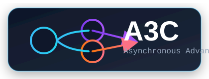
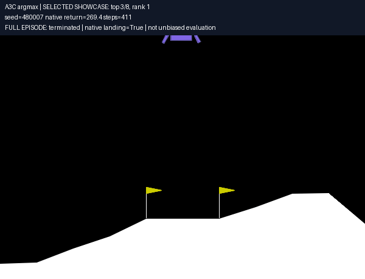
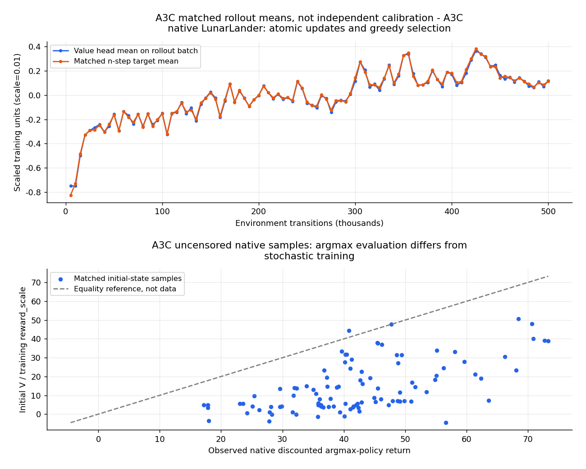
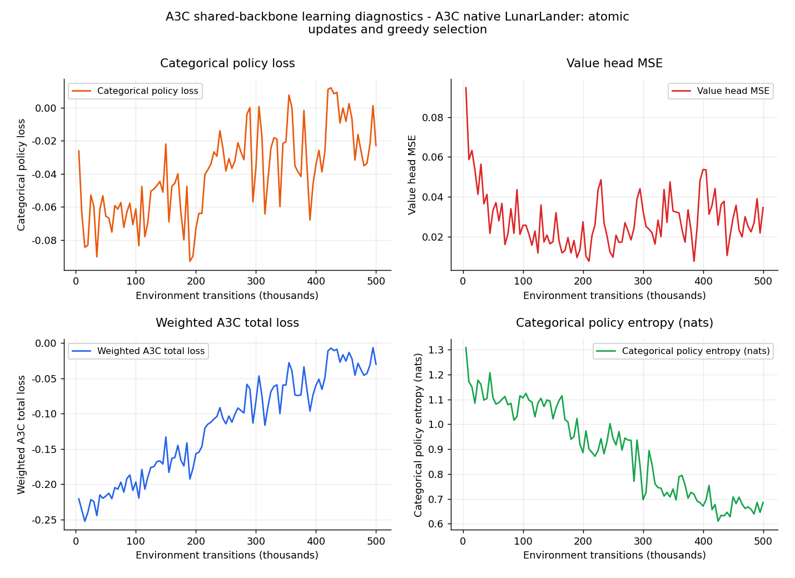
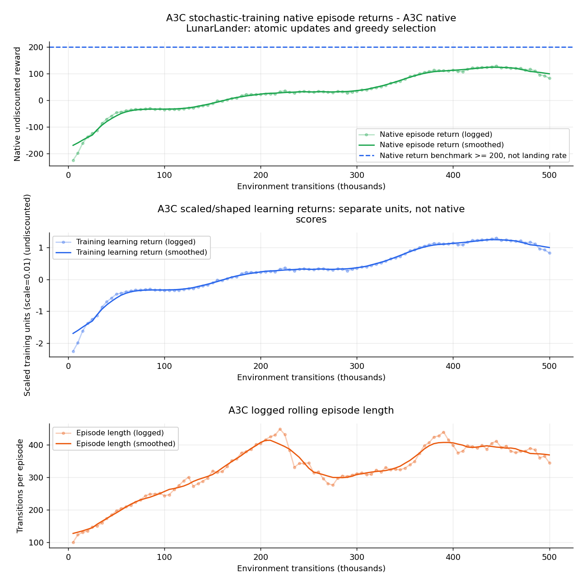

<p align="center">
  
</p>
<p align="center">
  
</p>

# A3C: Asynchronous Advantage Actor-Critic

## Overview

A3C collects trajectories in independent worker processes. Each worker owns a
local actor-critic model, computes one n-step gradient, applies it to shared
parameters, and refreshes its local model. There is no replay buffer.

The development-selected checkpoint achieved **210.68 +/- 60.32 native return
over 200 independent greedy episodes**, meeting LunarLander's +200 mean-return
benchmark in both 100-episode ranges. It made192 native landings,135 on the pad,
and had8 crashes with no timeouts. This is not a guarantee of perfect landings,
new dynamics, or convergence from every training seed.

## Highlights

- CPU shared-memory actor-critic and shared Adam moments/counters.
- Asynchronous environment collection and local gradients, with a short
  reentrant critical section around updates, local synchronization, and coherent
  checkpoint snapshots. This is **not a synchronized A2C rollout barrier**.
- Scalar and SAME_STEP vector environments with distinct worker/environment
  seeds and no reset-only transitions.
- True termination suppresses bootstrap. Timeouts use the actual final
  observation, never the auto-reset observation.
- Budgets are reserved before stepping. Outstanding reservations and the last
  partial rollout finish before a successful run is reported.
- Worker errors, missing completion reports, abnormal exits, and shutdown
  timeouts cannot silently become successful training runs.
- Finite losses and gradients, checked norm clipping, singleton-safe population
  normalization, and no stale gradient reuse or Adam step for rejected updates.
- Native returns remain separate from learning rewards after scaling/shaping.
- Public greedy checkpoint selection uses **all development episodes**, including
  failures, and preserves original snapshots byte-for-byte.

## What is A3C?

A local policy generates actions while other workers update the shared model.
Its gradient can therefore be stale when applied. Parallelism decorrelates data,
but does not eliminate policy-lag or convergence variability. Parameter updates
are atomic here so Adam state and saved model tensors are coherent; workers do
not wait for a global batch before collecting their next rollout.

The network uses a shared MLP backbone with a categorical policy head and a
scalar value head. Flat `Box` observations and zero-based `Discrete` actions are
supported. Shared-memory training is CPU-only; `device: auto` resolves to CPU.

## The math

Let $z_t$ mean true termination and $d_t$ any episode boundary. Let $\tilde r_t$
be the explicitly transformed **learning reward**, which is native reward times
`reward_scale` in the LunarLander recipes.

### Boundary-aware n-step returns

For an ordinary transition, recurse through the rollout. At a timeout, use the
actual endpoint value but stop recursion into the next reset episode:

$$
R_t=\tilde r_t+\gamma\left[(1-d_t)R_{t+1}
+d_t(1-z_t)V_{\theta'_k}(s'_{t})\right]
$$

At an unfinished rollout end, $R_T=V_{\theta'_k}(s_T)$. At a true terminal the
bootstrap is zero. Vector boundaries are handled independently per environment.

$$
A_t=R_t-V_{\theta'_k}(s_t)
$$

Optional normalization uses the active rollout's population standard deviation;
a singleton normalized advantage is zero. Standard unnormalized advantages are
also supported. Normalization is an algorithmic option, not a substitute for a
well-calibrated baseline or guaranteed convergence.

### Actor, critic, and entropy

$$
\pi_{\theta'_k}(a\mid s)=\operatorname{softmax}(W_\pi h_{\theta'_k}(s)+b_\pi)_a,
\qquad V_{\theta'_k}(s)=W_Vh_{\theta'_k}(s)+b_V
$$

$$
L_\pi=-\mathbb E[\log\pi_{\theta'_k}(a_t\mid s_t)\operatorname{stopgrad}(A_t)]
$$

$$
L_V=\mathbb E[(V_{\theta'_k}(s_t)-\operatorname{stopgrad}(R_t))^2]
$$

$$
\mathcal H_t=-\sum_a\pi_{\theta'_k}(a\mid s_t)\log\pi_{\theta'_k}(a\mid s_t),
\qquad L=L_\pi+c_VL_V-c_H\mathbb E[\mathcal H_t]
$$

Value loss is MSE, not half-MSE. Losses and value targets use learning-reward
units. Greedy evaluation uses raw native rewards and categorical argmax without
sampling policy RNG. A positive reward scaling factor is explicit training
conditioning; it is never silently treated as a native evaluation score.

### Shared Adam update

After checking and clipping the local gradient $g_k$, shared Adam performs:

$$
m\leftarrow\beta_1m+(1-\beta_1)g_k,\qquad
v\leftarrow\beta_2v+(1-\beta_2)g_k^2
$$

$$
\theta\leftarrow\theta-\alpha_t\frac{\hat m}{\sqrt{\hat v}+\epsilon}
$$

The update, last-successful learning-rate scalar, and local parameter refresh
are protected by the same lock. Invalid gradients are cleared without
sanitizing model weights or advancing Adam. Rollouts remain asynchronous and
fixed to their worker's local parameters until the update.

### Algorithm summary

1. Seed the shared model and create independent, staggered worker environments.
2. Reserve available transition slots before each environment step.
3. Collect up to `t_max` transitions, keeping terminal/timeout endpoint evidence.
4. Compute n-step targets and a local policy/value/entropy gradient once.
5. Apply the checked gradient atomically, then copy the current shared model.
6. Report native episodes and learning diagnostics through the result queue.
7. Validate every worker's clean exit and completed totals before final success.
8. Compare saved snapshots on separate development episodes, then freeze and
   verify the chosen model on independent evaluation seeds.

| Quantity | Code |
| --- | --- |
| Shared backbone and heads | `ActorCritic` |
| Boundary-aware targets | `compute_returns`, `next_values_sequence` |
| Local rollout and active budget | `worker_process` |
| Actor/value/entropy losses | `A3CAgent.compute_loss`, `A3CStats` |
| Shared update and synchronization | `A3CAgent.apply_gradients`, `sync_local` |
| Native versus learning rewards | `NativeEpisodeStats`, `RewardScaler` |
| Coherent state and saved LR | `SharedAdam`, `main._save_agent` |
| Development-only greedy selection | `utils.select_checkpoint` |

## Environment

Default training uses **LunarLander-v3**, with8 observation features,4 discrete
motor choices, stock gravity/physics/rewards, and a native1,000-step limit.
Gymnasium's +200 mean-return benchmark is distinct from physical touchdown or
pad location. Helpers record native landing, pad landing, crash, out-of-bounds,
truncation, and caps separately; missing native evidence remains unknown.

LunarLander training scales rewards by0.01 without custom shaping. Evaluation
and GIFs use **unscaled, unshaped stock rewards** and original native horizons.
Alternative CartPole and Acrobot configs remain available. Acrobot's optional
potential shaper zeros potential at true terminals; its shaped training value
must not be presented as a native value-calibration result.

## Quickstart

From the repository root, use a **new named uv environment for each run**:

```bash
export UV_PROJECT_ENVIRONMENT="$PWD/.venv-a3c-training"
uv venv "$UV_PROJECT_ENVIRONMENT"
uv sync --locked
WANDB_MODE=offline OMP_NUM_THREADS=1 MKL_NUM_THREADS=1 \
  uv run python -m A3C.main train --config A3C/configs/lunarlander.yaml
```

Use another fresh environment for development selection:

```bash
uv run python -m A3C.utils.select_checkpoint \
  --config A3C/configs/lunarlander.yaml --episodes 20 --seed 90000
```

This writes the byte-identical selected snapshot to
`A3C/checkpoints/best_greedy.pt`, retaining sampled-training `best.pt` and all
numbered inputs. The deployment config is `lunarlander_greedy.yaml`, not a new
training algorithm. `main.demo` and evaluation/GIF defaults follow that config.

```bash
uv run python -m A3C.main demo --episodes 5 --render_mode human
# Headless: --render_mode none
```

Only load trusted checkpoints. Checkpoints are gitignored; use the model supplied
with the handoff or train/select locally. Box2D is included in project dependencies.
The explicit SAME_STEP API requires Gymnasium1.1 or newer. W&B is enabled offline
in examples; CLI key, `WANDB_API_KEY`, then YAML key take precedence. Secrets are
excluded from public configuration and checkpoint metadata.

## Configuration and checkpoint semantics

- `num_workers`, `num_envs`, `t_max`: independent workers and batch/rollout width.
  `total_steps` must be divisible by `num_envs` for exact batched reservations.
- `reward_scale`, `reward_shaping`, `normalize_advantages`: explicit learning
  choices. Native episode bookkeeping is recorded before these transformations.
- `best_window`: both the minimum number of completed episodes and the sampled
  native-return window. A high sampled window is **not** a greedy benchmark.
- `worker_timeout`, `shutdown_timeout`: bounded reporting and process cleanup.
- `env_kwargs`, `max_steps_per_episode`: explicit environment settings and training
  safety cap, never silently lengthening a registered native limit.

Live progress and periodic/best snapshots are tagged **reserved transitions**.
Only a final snapshot made after clean worker exits and exact completed totals
has `training_completed: true`. A good intermediate policy can still be selected
for inference; its tag is not a claim that the entire configured run ended there.

Saved model and optimizer tensors are cloned together under the update lock.
The applied LR is shared and captured, not a stale process-local scalar. Optimizer
restoration must happen before spawning workers; checkpoints do not restore
worker environments, RNG, queues, or pending rollouts for exact process resumption.

## Training results and analysis

All following greedy checks retained every episode on native LunarLander.
Reward >=200 is an episode-score diagnostic; the solved benchmark concerns the
**mean over100 episodes**, not a landing-rate threshold.

| Model | Episodes | Native mean +/- population std | Native landings | Timeouts |
| --- | --- | --- | --- | --- |
| Untouched stock, sampled-window selected |100|123.58 +/-128.96|69|2|
| Corrected baseline, sampled-window selected |100|101.75 +/-111.83|49|44|
| First tuned profile, sampled-window selected |100|105.73 +/-123.37|69|4|
| Raw-advantage comparison, sampled-window selected |100|28.35 +/-145.16|46|6|
| Development-selected baseline, 380000-380099 |100|212.04 +/-47.80|99|0|
| Same frozen model, 580000-580099 |100|209.32 +/-70.62|93|0|

The corrected baseline completed exactly500,000 interactions. Its sampled
20-episode best score208.84 was misleading for greedy deployment: that snapshot
averaged101.75. A development-only comparison of complete native episodes chose
an earlier coherent snapshot tagged250,004 reserved transitions. Its development
mean was229.80 over20 episodes; the **independent200-episode mean is210.68**.
Selection preserves checkpoint bytes and does not change actions or physics.

The first tuned and raw-advantage profiles remain as documented unsuccessful
comparisons. They do not establish that one coefficient or normalization choice
caused the outcome. The selected controller has135/200 pad landings and141/200
individual scores>=200;192/200 native touchdowns is not192 perfect landings.
These are related runs with one training seed and asynchronous scheduling, not
multi-training-seed robustness evidence or a promise of convergence every time.

The GIF selects3 of8 complete episodes, with native returns269.39,255.00,244.48.
All three displayed episodes finish upright on the pad with engines off. It is a
showcase, not a filtered substitute for the independent raw failure records.
Encoded GIF frames may merge repeated holds while preserving total duration;
metadata reports submitted frames, encoded frames, and actual duration separately.

## Evaluation, assets, and tests

```bash
uv run python -m A3C.utils.evaluate --episodes 100 --seed 380000 \
  --out A3C/logs/selected-native-evaluation.json

SDL_VIDEODRIVER=dummy uv run python -m A3C.utils.make_gif \
  --episodes 8 --keep-top 3 --seed 480000

uv run python -m A3C.utils.make_charts \
  --config A3C/configs/lunarlander.yaml \
  --run wandb/<offline-run>/run-<id>.wandb \
  --evaluation A3C/logs/selected-native-evaluation.json \
  --summary A3C/logs/training-summary.json
```

The strict fresh-environment suite passed **80 tests and211 subtests** with
warnings treated as errors. Use distinct unused environments for test and
validation runs. Unit tests stub
physics, W&B, and process scheduling; real worker smoke, training, and complete
native rollouts are additional hardware checks, not unit-test substitutes.

```bash
OMP_NUM_THREADS=1 MKL_NUM_THREADS=1 WANDB_MODE=offline \
  uv run python -m pytest tests/a3c/ -q -W error
```

See [helpers](utils/README.md) for full-record JSON, provenance, checkpoint safety,
selected GIFs, local W&B parsing, and development-versus-held-out separation.

## Training charts

<p align="center"></p>

Training value/target means use the same learning-reward units and rollout
samples. The native initial-state scatter is a greedy-policy-shift diagnostic,
not proof that the stochastic training value is perfectly calibrated.

<p align="center"></p>

Finite losses do not alone establish valid gradients or a good deployment model.

<p align="center"></p>

Charts use the corrected baseline's100 logging rows. Native and scaled rewards
have separate axes and labels. Later training degradation and failed comparisons
are retained; the deployed policy is the independently verified earlier snapshot.

## References

- Mnih et al., [Asynchronous Methods for Deep Reinforcement Learning](https://arxiv.org/abs/1602.01783).
- [Gymnasium LunarLander](https://gymnasium.farama.org/environments/box2d/lunar_lander/).
- Sutton and Barto, *Reinforcement Learning: An Introduction*, policy-gradient methods.
