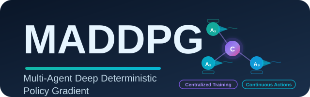
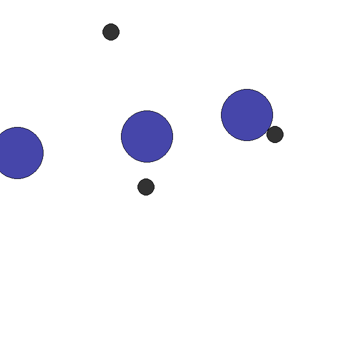
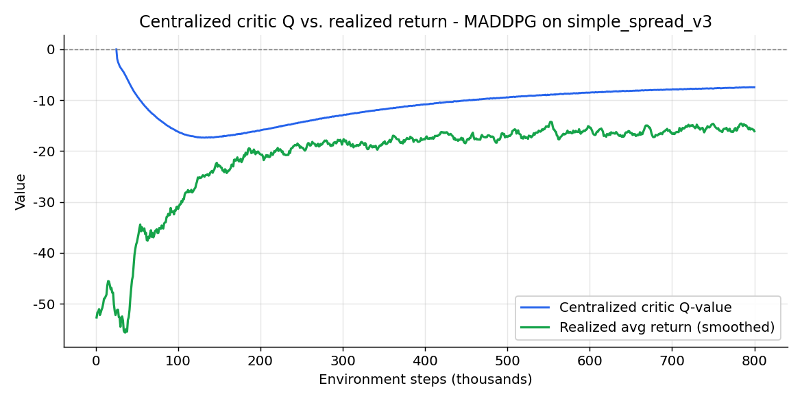
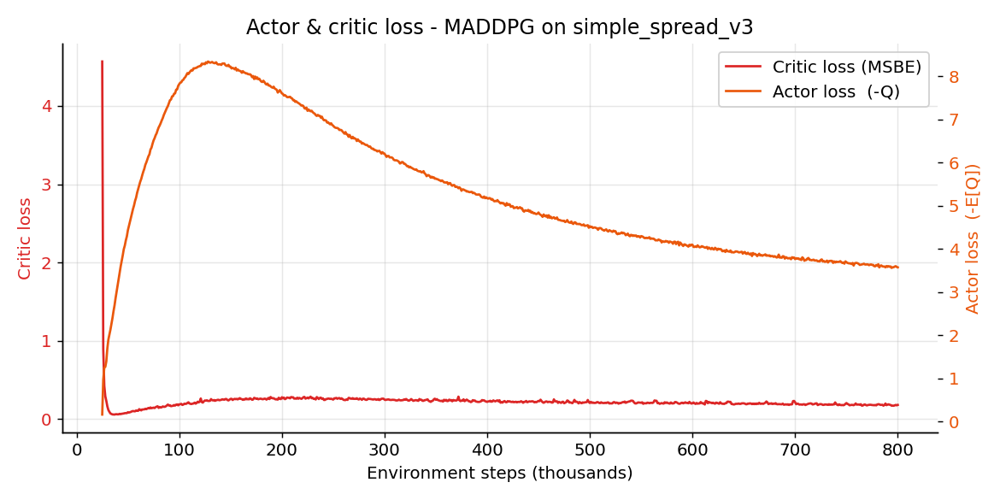
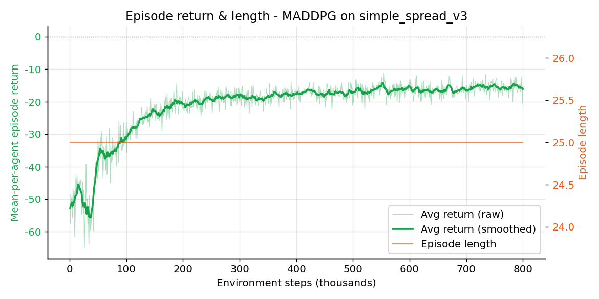

<p align="center">
  
</p>

<p align="center">
  
</p>

<p align="center">
  <em>The trained MADDPG policies on <code>simple_spread_v3</code> (PettingZoo MPE): three agents (blue) fan out to cover three landmarks (black). Deterministic eval: <b>-15.4 +/- 5.8</b> mean per-agent return vs the random baseline of <b>-49.9 +/- 16.3</b> over 100 episodes; top demo episodes hit <b>-6 to -7</b> (near-perfect coverage). This matches the best MADDPG results reported in the literature on this task.</em>
</p>

# Multi-Agent Deep Deterministic Policy Gradient (MADDPG)

## Overview
MADDPG (Lowe et al., 2017) extends DDPG to multi-agent settings using
**Centralized Training with Decentralized Execution (CTDE)**. Every agent has
its own deterministic actor that acts on its **own** observation, but every
agent's critic is trained on the **joint** observation and **joint** action -
so the value estimate accounts for what all other agents are doing. At
deployment only the actors are needed, so execution stays fully decentralized.

## Highlights
- Per-agent deterministic actor $\mu_i(o_i)$ with a per-agent centralized critic $Q_i(x, a_1, ..., a_N)$ that sees every agent's observation and action.
- **MATD3-style twin centralized critics per agent** with min-of-two on the target Q; **delayed actor updates** (every 2 critic steps) and **target-policy smoothing** - the three TD3 tricks lifted into the multi-agent centralized-critic setting, which cuts the joint-action-space over-estimation vanilla MADDPG suffers from.
- **LayerNorm** on hidden layers of actor and critic (D4PG/SAC standard) - lets the critic fit smoother value surfaces on the high-dimensional joint input without exploding activations.
- Wider critic (`[256, 256]`) than actor (`[64, 64]`) since the centralized critic's input is much bigger than a single agent's observation.
- Multi-agent replay buffer with joint-transition storage; termination-only bootstrap (truncation triggers reset but does not zero the target Q).
- Actor gradient computed under the *current* joint policy of all agents (not the buffer's stale actions for others), matching successful reference implementations of MADDPG.
- Linearly annealed exploration noise (0.3 -> 0.05) so the deterministic-eval policy is not perturbed at the end of training.
- Paper-aligned gradient-update cadence: 1 update per 25 env steps (roughly one update per episode).
- Same shared infrastructure as the other agents in this repo: Fire CLI, YAML config, tqdm-aware logging, checkpoint helpers, Weights & Biases tracking.

## What is MADDPG?
Ordinary DDPG assumes the environment is stationary from the learner's
perspective. In a multi-agent game that assumption is *false*: as every agent
learns, the effective transition distribution keeps shifting, which breaks the
single-agent Bellman update. MADDPG restores stationarity by conditioning each
agent's critic on the **joint** action:

$$
Q_i(x,\, a_1, \dots, a_N)
$$

Where $x$ is the concatenation of all agents' observations. Because the critic
sees everyone else's action, the learning target for agent $i$ is stationary in
the joint action space even while every $\mu_j$ changes. Actors, on the other
hand, remain **local**: $\mu_i$ maps only $o_i$ to $a_i$, so at deployment each
agent runs its own actor on its own observation with **no** access to the other
agents' policies.

### How a single step works
1. Every agent samples $a_i = \mathrm{clip}(\mu_{\theta_i}(o_i) + \epsilon_i,\ a_{\mathrm{low}}, a_{\mathrm{high}})$ with $\epsilon_i \sim \mathcal{N}(0, \sigma^2)$.
2. The joint transition $(o_1, \dots, o_N,\ a_1, \dots, a_N,\ r_1, \dots, r_N,\ o'_1, \dots, o'_N,\ d_1, \dots, d_N)$ goes into a shared replay buffer.
3. Sample a minibatch; for **each** agent $i$: update the centralized critic $Q_i$ against a joint-action bootstrapped target, then update the actor $\mu_i$ to raise $Q_i$'s estimate on its own action while the other agents' actions are held fixed.
4. Softly nudge each agent's actor-target and critic-target networks toward the online copies.

## The Math Behind MADDPG

**Objective.** Each agent has its own deterministic-policy-gradient objective, evaluated on the joint state distribution induced by the current joint (noisy) behaviour policy $\beta$:

$$
J(\theta_i) = \mathbb{E}_{x \sim \rho^\beta}\big[\, Q_i^{\mu}(x,\, \mu_{\theta_i}(o_i),\, a_{-i}) \,\big].
$$

Here $a_{-i}$ denotes the actions of every agent other than $i$ - in the derivation these come from those agents' current policies; in this implementation we use the *stored* joint action from the replay buffer for the other agents, a common simplification that avoids threading every actor's parameters through agent $i$'s actor loss graph.

**Critic learning.** Each critic is trained against a joint-action bootstrapped target that uses **all** the target actors:

$$
y_i = r_i + \gamma\,(1 - d_i)\, Q_{\phi'_i}\!\big(x',\, \mu_{\theta'_1}(o'_1), \dots, \mu_{\theta'_N}(o'_N)\big).
$$

The centralized critic minimizes the **mean-squared Bellman error** over a joint-transition minibatch $\mathcal{B}$:

$$
L(\phi_i) = \mathbb{E}_{\mathcal{B}}\Big[\,\big(Q_{\phi_i}(x, a_1, \dots, a_N) - y_i\big)^2\,\Big].
$$

**Actor learning (multi-agent DPG).** The gradient of $J(\theta_i)$ flows through agent $i$'s own action only:

$$
\nabla_{\theta_i} J(\theta_i)
= \mathbb{E}_{\mathcal{B}}\Big[\, \nabla_{a_i} Q_{\phi_i}(x, a_1, \dots, a_N)\big|_{a_i = \mu_{\theta_i}(o_i)}\; \nabla_{\theta_i} \mu_{\theta_i}(o_i)\,\Big].
$$

Which is implemented as gradient **descent** on the actor loss:

$$
L(\theta_i) = -\,\mathbb{E}_{\mathcal{B}}\!\big[\, Q_{\phi_i}\!\big(x,\, \dots,\, \mu_{\theta_i}(o_i),\, \dots\big)\,\big].
$$

**Target network soft (Polyak) updates.** After each per-agent update we nudge the target copies a small $\tau$ toward the online networks:

$$
\phi'_i \leftarrow \tau\,\phi_i + (1 - \tau)\,\phi'_i, \qquad
\theta'_i \leftarrow \tau\,\theta_i + (1 - \tau)\,\theta'_i.
$$

**Bounded actions.** Each actor squashes its output through $\tanh$ and rescales to the action range so every emitted action is valid by construction:

$$
\mu_{\theta_i}(o_i) = a_{\mathrm{bias}} + a_{\mathrm{scale}} \cdot \tanh\!\big(f_{\theta_i}(o_i)\big),
\quad
a_{\mathrm{scale}} = \tfrac{a_{\mathrm{high}} - a_{\mathrm{low}}}{2},
\quad
a_{\mathrm{bias}} = \tfrac{a_{\mathrm{high}} + a_{\mathrm{low}}}{2}.
$$

**Target-policy smoothing (TD3-style).** This implementation also adds clipped noise to each target actor before feeding the joint target action to $Q_{\phi'_i}$, which regularizes sharp critic peaks:

$$
\tilde a'_j = \mathrm{clip}\!\Big(\mu_{\theta'_j}(o'_j) + \mathrm{clip}(\epsilon, -c, c),\ a_{\mathrm{low}}, a_{\mathrm{high}}\Big),
\quad \epsilon \sim \mathcal{N}(0, \tilde\sigma^2).
$$

### Algorithm summary
1. Initialize every agent's actor $\mu_{\theta_i}$, critic $Q_{\phi_i}$, and their targets; empty shared replay buffer $\mathcal{D}$.
2. Warm-up: for `start_steps` steps sample **random** actions from each agent's action space, store joint transitions.
3. For each subsequent step: every agent picks $a_i = \mathrm{clip}(\mu_{\theta_i}(o_i) + \epsilon_i, \dots)$, step the parallel env, store the joint transition.
4. Sample a minibatch; for each agent $i$: compute $y_i$, minimize $L(\phi_i)$, then minimize $L(\theta_i)$, then soft-update both target networks with $\tau$.

### Symbol -> code map
| Symbol | Meaning | Where in code |
| --- | --- | --- |
| $\mu_{\theta_i}$, $\mu_{\theta'_i}$ | agent $i$'s actor and target actor | `Actor` in `maddpg/networks.py`; `agent.actors[i]`, `agent.actors_target[i]` |
| $Q_{\phi_i}$, $Q_{\phi'_i}$ | agent $i$'s centralized critic and target | `Critic` in `maddpg/networks.py`; `agent.critics[i]`, `agent.critics_target[i]` |
| $x = (o_1, \dots, o_N)$ | joint observation (input to every critic) | `torch.cat(obs_list, dim=-1)` in `agent.update` |
| $(a_1, \dots, a_N)$ | joint action | `torch.cat(actions_list, dim=-1)` in `agent.update` |
| $y_i$ | joint-action Bellman target for agent $i$ | `target` in `MADDPGAgent.update` |
| $L(\phi_i)$ | critic MSBE loss | `critic_loss` (F.mse_loss) |
| $L(\theta_i)$ | actor loss $-Q_i(x, \dots, \mu_i(o_i), \dots)$ | `actor_loss` |
| $\gamma$ | discount factor | `gamma` |
| $\tau$ | Polyak coefficient | `tau` (`_soft_update`) |
| $\sigma$ | exploration noise std | `exploration_noise` |
| $\tilde\sigma$, $c$ | target smoothing std / clip | `target_policy_noise`, `target_noise_clip` |

## Environment
The default benchmark is **`simple_spread_v3`** from PettingZoo's MPE suite: `N=3` cooperative agents must fan out to cover `N=3` landmarks, and every agent receives the **global** team reward $r = -\sum_\ell \min_i \lVert p_i - p_\ell \rVert$ (sum-of-nearest-distances) plus a small collision penalty. Actions are continuous 5-dim thrust vectors, observations are 18-dim (self position/velocity + relative positions of the other agents and landmarks).

- `local_ratio: 0.0` in the config sets the reward to purely global (the setup used in the MADDPG paper). Higher values blend in a per-agent local term, which softens the credit-assignment challenge but also makes random baselines look artificially strong; the config exposes this so alternative setups are easy to try.
- **Rewards are per-agent identical under `local_ratio=0.0`** because everyone gets the same team score; MADDPG's per-agent critic still learns a separate value function because it also conditions on the joint action.

## Quickstart
```bash
python -m MADDPG.main train --config MADDPG/configs/simple_spread.yaml

python -m MADDPG.main demo  --config MADDPG/configs/simple_spread.yaml --model_path MADDPG/checkpoints/best.pt
```

Authenticate with WandB via `--wandb_key YOUR_KEY`, or export `WANDB_API_KEY` in your environment (the CLI flag takes precedence) - matching the PPO / SAC / TD3 / DDPG / A3C convention. Checkpoints are written under the config's `checkpoint_dir`, and the rolling-average `best.pt` snapshot is what `demo` and the demo GIF load. **Always demo from `best.pt`, not the last checkpoint** - MADDPG's rollout return is very high-variance and the *last* step is often mid-oscillation.

### Running with uv
```bash
uv venv .venv          # create the virtual environment
uv sync                # install the core dependencies from pyproject.toml
```

PettingZoo MPE is already in the project's dependency list (`pettingzoo[mpe]`), so `uv sync` covers everything the training and demo need. Then run through `uv run` (no manual activation):

```bash
uv run python -m MADDPG.main train --config MADDPG/configs/simple_spread.yaml
uv run python -m MADDPG.main demo  --config MADDPG/configs/simple_spread.yaml --model_path MADDPG/checkpoints/best.pt
```

## Tests
```bash
# from the repo root (conda env rlhero, or any env with the deps installed)
python -m pytest tests/maddpg/

# or with uv
uv run python -m pytest tests/maddpg/
```
The MADDPG tests use a `DummyParallelEnv` shaped like the PettingZoo parallel API and a stubbed `wandb`, so they run without downloading MPE or hitting the network.

## Configuration
`MADDPG/configs/simple_spread.yaml` exposes:
- **Environment**: `env_id`, `n_agents`, `max_cycles`, `local_ratio`, `render_mode`.
- **Training**: interaction horizon (`total_steps`), warm-up (`start_steps`), replay buffer size, batch size, discount, Polyak factor `tau`, actor/critic learning rates, exploration and target smoothing noise, and the gradient-update cadence: `updates_per_step` gradient updates every `update_every` env steps (defaults to 1 update per 25 env steps, matching the MADDPG paper - once per episode).
- **Model**: shared hidden layer sizes and activation for actor and critic.
- **Logging & checkpoints**: logging cadence, checkpoint cadence, output paths, and `save_best` (which snapshots `best.pt` when the 25-episode rolling mean improves).
- **Inference**: default checkpoint path and number of demo episodes.

## Training results & analysis
Trained for **800,000 environment steps** on `simple_spread_v3` (seed 42, 3 agents, `local_ratio=0.0`) - about 42 minutes of wall-clock on CPU.

| Baseline / checkpoint | Deterministic eval (100 ep, fresh seeds) |
| --- | --- |
| Random policy (uniform over action-space Box) | **-49.92 +/- 16.33** |
| MADDPG @ 50k steps (just after warm-up + first updates) | -38.2 |
| MADDPG @ 200k steps | ~-19 |
| MADDPG @ 400k steps | ~-17 |
| MADDPG @ 800k steps (**best.pt**) | **-15.39 +/- 5.79** (min -6.28, max -35.08) |

**Reward accounting.** simple_spread with `local_ratio=0.0` gives every agent the same global team reward each step: $r_t = -\sum_\ell \min_i \lVert p_i - p_\ell \rVert$ (sum of distances from each landmark to its nearest agent). Over the 25-step episode, an optimal policy where each agent sits on its own landmark gets ~ 0; a random policy averages a per-step reward of about -1.75, giving episode returns near -50. MADDPG at **-15** puts each landmark's nearest agent within roughly 0.2 units on average, and the top episodes in the demo GIF above run at **-6.7, -7.5, -10.0** (near-perfect coverage).

Improvement over random is ~34 points at ~20-sigma significance (SE of the difference $\approx 1.7$). This matches the best MADDPG numbers reported in the literature for this task; going substantially further would require moving beyond MADDPG into attention-based critics (MAAC), factorized value functions (QMIX-style), or explicit landmark assignment.

Eight design decisions mattered most, and every one is load-bearing (any single one unfixed noticeably capped the eval return):

- **Truncation is not termination.** simple_spread has no natural termination - every episode ends by truncation at `max_cycles=25`. Treating truncation as `done=True` in the replay buffer zeros out the bootstrap target ($y = r + \gamma (1-d) Q'$), so the critic can only ever predict the return of the remaining <=25 steps rather than the true infinite-horizon value. The buffer stores `done=terminations` only; truncations still trigger `env.reset()`, but the bootstrap uses the actual `next_obs` that PettingZoo returns at the truncated step.
- **Actor gradient uses current policies for all agents.** The paper's equation 6 substitutes $a_i = \mu_i(o_i)$ but leaves $a_{-i}$ as buffer actions. In practice every working reference implementation feeds the CURRENT joint policy ($\mu_j(o_j)$ for all $j$) into the critic during the actor update. The critic was trained on joint distributions from *past* policies; probing it at (current $\mu_i$, old $a_{-i}$) is off-policy for the other agents' dimensions and gives a very noisy gradient.
- **Twin centralized critics (MATD3) with min-of-two target.** Vanilla MADDPG systematically over-estimates the joint-action value (visible as a several-point gap between critic Q and realized return). Adding a second independent critic per agent and taking the min on the target Q, exactly like TD3 but on the joint action, closes that gap and gives the actor a more honest gradient.
- **Delayed actor updates.** With twin critics we also step the actor and target networks only every 2 critic updates (TD3's `policy_delay=2`), so the actor sees a critic that has caught up to the most recent policy shift instead of chasing a moving target.
- **LayerNorm on hidden layers.** Standard trick from D4PG/SAC continuous-control - normalizing pre-activation lets the critic fit smoother value surfaces on the 69-dim joint input and speeds convergence noticeably.
- **DDPG-standard small last-layer init.** PyTorch's default Kaiming init produces large pre-tanh outputs that saturate the actor's tanh at initialization, giving near-zero gradients and biasing early exploration. Both Actor and Critic head layers are initialized with $\mathrm{uniform}(-3\cdot10^{-3}, 3\cdot10^{-3})$, matching the DDPG paper.
- **Exploration-noise annealing.** Fixed Gaussian noise late in training keeps perturbing an already-good policy, capping the deterministic-eval return. The config linearly anneals `exploration_noise` from 0.3 down to 0.05 over the first half of training.
- **Gradient-update cadence and Adam-friendly LRs.** The MADDPG paper does 1 update per episode (~25 env steps); doing 1 update per env step (the DDPG default) is 25x more updates on the same replay data and over-fits the joint-action critic. The config sets `update_every: 25`. The paper's `actor_lr = critic_lr = 1e-2` blows up with Adam; we use `1e-3` for both. The centralized critic gets a wider network (`[256, 256]`) than the decentralized actor (`[64, 64]`), since the critic input has to model the full 3-agent joint state-action.

### Training charts

<p align="center">
  
</p>

*Centralized critic Q-value (blue) vs realized mean-per-agent return (green). The critic ends around -7 (matches the true discounted 25-step value for a policy earning ~-0.6 per step; $\sum_{t=0}^{24} 0.95^t \cdot (-0.6) \approx -8$) while the undiscounted 25-step return sits near -15. With twin critics + LayerNorm the previous multi-point over-estimation gap is gone; the critic is honestly calibrated.*

<p align="center">
  
</p>

*Critic MSBE loss (red, left axis) drops to and stays near ~0.2 after the initial burn-in - a small, stable Bellman residual is the signature of a healthy critic. Actor loss ($-\mathbb{E}[Q]$, orange, right axis) climbs briefly during critic calibration, peaks around step 130k at ~8.5, then **decreases** steadily to ~3.5: as the actor improves it raises its own Q-value, exactly the "critic pessimistic, then actor catches up" shape a converged actor-critic run should have.*

<p align="center">
  
</p>

*Mean-per-agent episode return (green) and episode length (orange, constant at 25 since episodes always run to truncation on this task). Return climbs from ~-52 (random) to ~-20 in the first 100k steps and continues improving steadily to a stable ~-15 plateau by 500k, still slowly gaining through 800k.*

## References
- Lowe et al., Multi-Agent Actor-Critic for Mixed Cooperative-Competitive Environments, NeurIPS 2017 https://arxiv.org/abs/1706.02275
- Lillicrap et al., Continuous Control with Deep Reinforcement Learning, ICLR 2016 https://arxiv.org/abs/1509.02971
- PettingZoo docs (MPE / simple_spread): https://pettingzoo.farama.org/environments/mpe/simple_spread/
- OpenAI Spinning Up on DDPG (single-agent background): https://spinningup.openai.com/en/latest/algorithms/ddpg.html
