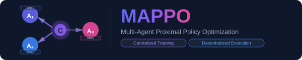
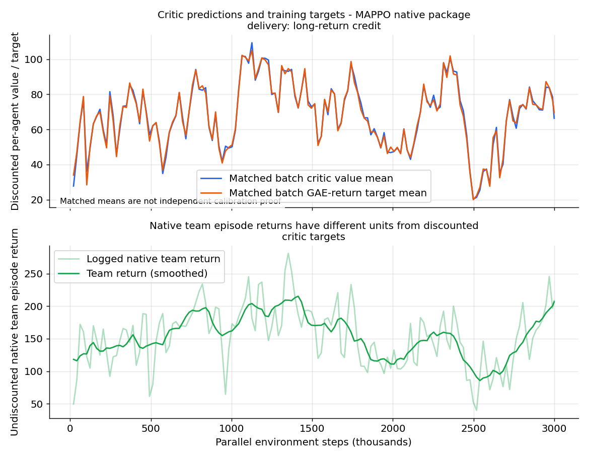
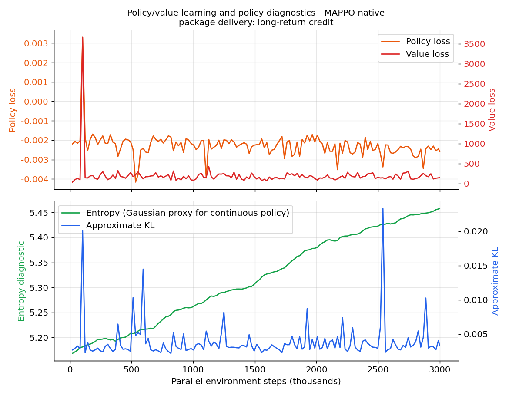
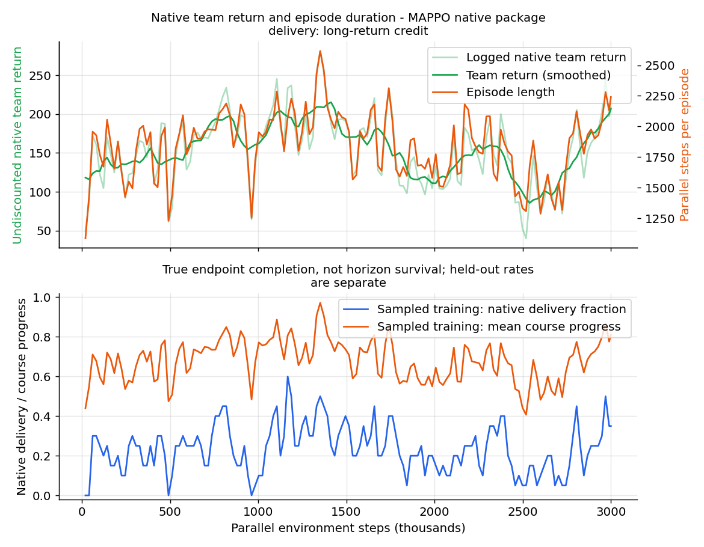

<p align="center">
  
</p>
<p align="center">
  
</p>

# Multi-Agent Proximal Policy Optimization (MAPPO)

MAPPO trains decentralized local-observation actors with a joint-observation
critic. This implementation supports continuous/discrete actions, shared/separate
policies, and central/local critics. The MultiWalker delivery recipes use three
walkers, continuous actions, and one shared actor-critic model.

**The model can complete the full native course, but delivery is not reliable
 yet: 11 of 60 independent deterministic episodes delivered the package.** The
GIF is one successful full episode; it is not a success-rate estimate. Remaining
episodes ended in package drops or walker falls. Do not confuse balancing or
surviving a horizon with completing transport.

## Implementation

- A tanh-squashed Gaussian produces bounded motor actions. Optional action-grid
  discretization uses categorical policies instead.
- Shared updates pool active-agent samples into one optimizer step. Separate
  policies update only live agent batches. Removed agents keep zero-padded
  observation slots, and only active IDs receive actions.
- Transition-aligned GAE distinguishes true termination from time limits.
  Timeouts bootstrap the actual pre-reset observation and stop cross-episode
  recursion. Critic-only value queries do not consume action RNG.
- Parallel training uses spawned, CPU-only independent environment workers.
  The parent owns the policy and optimizer. Budgets count **team environment
  transitions**, with active-agent transitions logged separately.
- Delivery recipes use separate actor/critic learning rates and independent
  gradient clipping, with value-loss clipping disabled. The original clipped
  value-loss option remains available.
- Numerical rejection checks run before exponentiation and Adam. Invalid losses,
  gradients, or gradient norms never become optimizer steps. A rejected update
  clears gradients and stops the remaining epochs so the next rollout is fresh.
- Optional running input normalization is checkpointed and frozen within each
  rollout/update. It is **off** in the warm-start delivery experiments, preserving
  the pretrained ReLU actor's input function.
- Native goal, progress, speed, and stall diagnostics are reporting only. They
  are never extra actor inputs, rewards, teacher actions, or scripted controls.

## The math

Let $o_t^i$ be agent $i$'s observation, $x_t=[o_t^1;\ldots;o_t^N]$ the padded
joint critic input, $m_t^i$ its pre-transition active mask, $z_t^i$ true
termination, and $d_t^i$ an episode boundary, including truncation.

### GAE

$$
\delta_t^i=r_t^i+\gamma(1-z_t^i)V_{\mathrm{old}}(x'_t)-V_{\mathrm{old}}(x_t)
$$

$$
\hat A_t^i=\delta_t^i+\gamma\lambda(1-d_t^i)\hat A_{t+1}^i,\qquad
\hat R_t^i=\hat A_t^i+V_{\mathrm{old}}(x_t)
$$

True terminals suppress bootstrapping. Time limits retain the final-observation
bootstrap, but advantages cannot flow into the reset episode. Inactive samples
are excluded; advantages use population standard deviation over active samples.

### PPO and value loss

$$
\rho_t^i=\frac{\pi_\theta(a_t^i\mid o_t^i)}{\pi_{\mathrm{old}}(a_t^i\mid o_t^i)}
$$

$$
L_\pi=-\mathbb E_{(t,i):m_t^i=1}\left[\min\left(
\rho_t^i\hat A_t^i,\operatorname{clip}(\rho_t^i,1-\epsilon,1+\epsilon)\hat A_t^i
\right)\right]
$$

The delivery recipes use unclipped native-unit critic regression:

$$
L_V=\tfrac12\mathbb E_{(t,i):m_t^i=1}[(V_\theta(x_t)-\hat R_t^i)^2],\qquad
L=L_\pi+c_VL_V-c_H\mathbb E[\mathcal H]
$$

When `clip_value_loss: true`, the implementation instead takes the maximum of
squared unclipped error and error from
$V_{\mathrm{old}}+\operatorname{clip}(V_\theta-V_{\mathrm{old}},-\epsilon,\epsilon)$.
Local critics substitute $o_t^i$ for $x_t$.

Before computing the exponential ratio, a minibatch with nonfinite outputs or
$|\log\pi_\theta-\log\pi_{\mathrm{old}}|>20$ is rejected. This is a **numerical
update-rejection safeguard**, not exact PPO clipping or a formal KL trust-region
guarantee. A finite clipped forward loss can otherwise hide exponential overflow
and nonfinite backward gradients. Accepted batches retain the stated PPO loss.
`stats/skipped_updates` records rejections, including all-rejected updates.
The approximate KL diagnostic is half the mean squared log-probability change;
`target_kl` can stop the remaining epochs after an accepted update.

### Continuous actions

$$
u\sim\mathcal N(\mu_\theta(o),\operatorname{diag}(\sigma^2)),\qquad
 a=b+c\odot\tanh(u)
$$

$$
\log\pi(a\mid o)=\sum_j\left[\log\mathcal N(u_j;\mu_j,\sigma_j)
-\log c_j-\log(1-\tanh^2u_j)\right]
$$

$b$ is the action-range midpoint and $c$ its half-width. Collection and
re-evaluation use the same finite inverse-tanh/Jacobian calculation. Entropy is
the unsquashed Gaussian proxy, not exact transformed entropy. Deterministic
continuous inference uses the squashed mean; discrete inference uses argmax.

| Quantity | Code |
| --- | --- |
| Local policy | `Actor`, `GaussianActor` |
| Joint/local value | `CentralizedCritic`, `DecentralizedCritic` |
| Active and endpoint masks | `main._transition`, `ParallelMultiwalker.step` |
| Batched action/value queries | `MAPPOAgent.act_many`, `values_many` |
| GAE and active-sample update | `MAPPOAgent.compute_gae`, `update` |
| Goal/progress reporting | `diagnostics.task_status`, `motion_summary` |
| Delivery-first training selection | `train_delivery.evaluate_candidate` |

## Native task and horizon

PettingZoo `multiwalker_v9` has 31 observations and four motor actions per
walker; the centralized critic receives 93 features. Native terrain length 200
has a goal at $(200-10)(14/30)=88.6667$. The package starts near 9.3333, requiring
about **79.3333 native x units** of transport.

Delivery requires the package to cross the native goal, all native simulator
done flags to be true, and no native package/walker failure. Failure takes
precedence. Missing engine evidence remains unknown. Termination alone is not
success, and timeout survival is a separate observation.

The original recipe's 500 steps are ten simulated seconds. Delivery recipes
explicitly allow **5,000 steps**, or 100 simulated seconds. This is a time-budget
change, not shortened terrain, moved goal, altered reward, or changed physics.
Native rewards remain forward reward 1, termination reward -100, fall reward -10,
shared rewards, removal on fall, and team termination on fall. The time-limit
adapter marks a pure native cycle limit as truncation without overriding a true
failure or delivery on that step.

## Run the trained model

From the repository root, choose a new environment name for each run:

```bash
export UV_PROJECT_ENVIRONMENT="$PWD/.venv-mappo-delivery-demo"
uv venv "$UV_PROJECT_ENVIRONMENT"
uv sync --locked

# Replay the successful full episode illustrated above.
uv run python -m MAPPO.main demo --episodes 1 --seed 530019 --render_mode human
```

Use `--render_mode none` headlessly. The default is
`configs/multiwalker_delivery_long_credit.yaml`, loading
`MAPPO/checkpoints_delivery_long_credit/best.pt`. Checkpoints are intentionally
ignored; use the trained checkpoint supplied with the handoff or reproduce the
training chain. Only load trusted checkpoints. A known successful replay is an
illustration, not a replacement for testing fresh seeds.

## Training and configurations

`main.train` dispatches configs with `num_envs > 1` to `train_delivery` rather
than silently ignoring parallelism. Each training stage needs a **fresh named
uv environment**. W&B is enabled; `WANDB_MODE=offline` retains local histories
without cloud synchronization. CLI key, environment key, and YAML key take that
precedence, and keys are redacted from logged config.

The retained configuration chain is:

1. `multiwalker.yaml`: original moving baseline recipe.
2. `multiwalker_delivery.yaml`: model-weight warm start from the moving baseline,
   16 environments, original gamma/lambda, separate actor/critic clipping/rates,
   and unclipped critic regression. Its run exposed nonfinite actor parameters;
   the finite selected checkpoint and failed run remain recorded.
3. `multiwalker_delivery_recovery.yaml`: fresh Adam, actor LR `5e-5`, checked
   updates, three million additional transitions. Its frozen checkpoint delivered
   5/40 independent episodes.
4. `multiwalker_delivery_long_credit.yaml`: fresh Adam from that recovery model,
   gamma `0.9995`, GAE lambda `0.99`, and three million additional transitions.
   Other native-task and optimizer settings remain unchanged.

```bash
# Create a fresh named environment before this training run.
WANDB_MODE=offline OMP_NUM_THREADS=1 MKL_NUM_THREADS=1 \
  uv run python -m MAPPO.main train \
  --config MAPPO/configs/multiwalker_delivery_long_credit.yaml
```

`init_checkpoint` in YAML documents the predecessor. `--init_checkpoint PATH`
overrides it. Warm starts restore **model weights, not optimizer/RNG/environment
state**. Optional normalization layout, team size, architecture, and action
bounds must match. This is fine-tuning, not exact process resumption.

The parallel trainer selects `best.pt` lexicographically by **development
 delivery rate, mean course progress, then native return**, never by survival.
Development selection used seeds 180000 onward. The selected long-credit model
is from transition 819,200 of that stage, not its latest checkpoint. This chain
is one related set of training runs, not evidence from independent training
seeds. `multiwalker_tuned.yaml` retains the former standing/survival control;
it is not the recommended locomotion model.

## Verified results and limitations

All following evaluations retain every requested episode and use deterministic
local actors with unchanged native terrain, rewards, and 5,000-step caps.

| Model / reset range | Episodes | Native deliveries | Mean displacement |
| --- | --- | --- | --- |
| Previous moving model, 120000-120009 | 10 | 0/10 | 12.58 |
| Previous standing model, 120000-120009 | 10 | 0/10 | 2.63 |
| Recovery, 230000-230019 | 20 | 3/20 | 58.56 |
| Recovery, 330000-330019 | 20 | 2/20 | 56.25 |
| Frozen long-credit model, 430000-430029 | 30 | 5/30 | 51.21 |
| Frozen long-credit model, 530000-530029 | 30 | 6/30 | 46.78 |

The final **11/60 (18.3%)** completion rate demonstrates real locomotion and
some full-course delivery, but it is **not robust transport**. The other 49
final episodes contained 35 package drops and 14 walker falls. None ended by
horizon survival. Differences between recovery and long-credit estimates use
different reset ranges; the small delivery-rate difference is not an isolated,
statistically established improvement from gamma/lambda.

The GIF replays successful seed 530019 from reset through native completion at
2,253 steps. All three walkers arrive upright with a nearly level package.
It was chosen for a clear coordinated arrival after auditing successful episodes;
no trajectory segment, script, action hint, or altered environment was inserted.
Raw rates above remain unfiltered. Native success does not promise parking or
continued safety after the simulator ends an episode.

## Evaluation, charts, and tests

Use another fresh environment for validation:

```bash
uv run python -m MAPPO.utils.evaluate \
  --config MAPPO/configs/multiwalker_delivery_long_credit.yaml \
  --episodes 30 --seed 430000 --out MAPPO/logs/delivery-final-a.json

SDL_VIDEODRIVER=dummy uv run python -m MAPPO.utils.make_gif \
  --config MAPPO/configs/multiwalker_delivery_long_credit.yaml \
  --episodes 1 --keep-top 1 --seed 530019 --stride 5 --fps 10 \
  --require-delivery --out MAPPO/assets/mappo_full_delivery.gif

uv run python -m MAPPO.utils.make_charts \
  --run wandb/<offline-run>/run-<id>.wandb --out-dir MAPPO/assets \
  --summary MAPPO/logs/delivery-training-summary.json
```

Evaluation JSON retains episode seeds, native flags, team/per-agent returns,
package progress and motion, checkpoint SHA-256, and config provenance. Helpers
never infer delivery from reward. See [utils](utils/README.md) for details.

The suite passed **99 tests and 121 subtests**, with warnings as errors, in a
fresh uv environment. Unit cases use fake environments/W&B; real worker smoke,
full training, independent complete episodes, and a native successful demo were
also executed on hardware. Use a separate fresh test environment:

```bash
OMP_NUM_THREADS=1 MKL_NUM_THREADS=1 WANDB_MODE=offline \
  uv run python -m pytest tests/mappo/ -q -W error
```

<p align="center"></p>

Bootstrapped value targets are not independent calibration measurements.

<p align="center"></p>

Finite losses alone neither prove valid gradients nor coordinated transport.

<p align="center"></p>

These charts come from the long-credit run's 147 logging rows. Sampled training
window delivery/progress is distinct from the unfiltered deterministic results
above. Source, tests, configs, docs, and assets are reviewable; checkpoints and
raw logs are ignored and retained separately.

## References

- Yu et al., [The Surprising Effectiveness of PPO in Cooperative Multi-Agent Games](https://arxiv.org/abs/2103.01955).
- Schulman et al., [Proximal Policy Optimization Algorithms](https://arxiv.org/abs/1707.06347).
- [PettingZoo MultiWalker](https://pettingzoo.farama.org/environments/sisl/multiwalker/).
