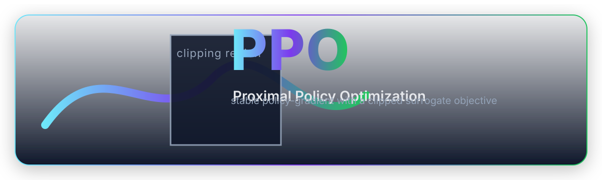
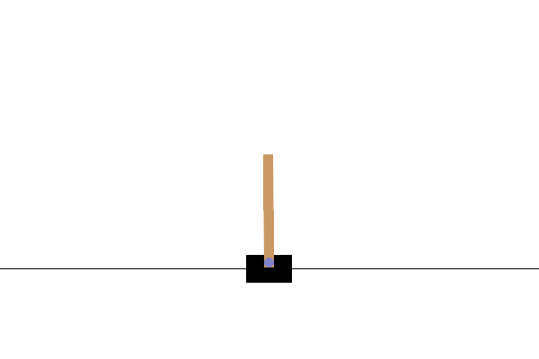
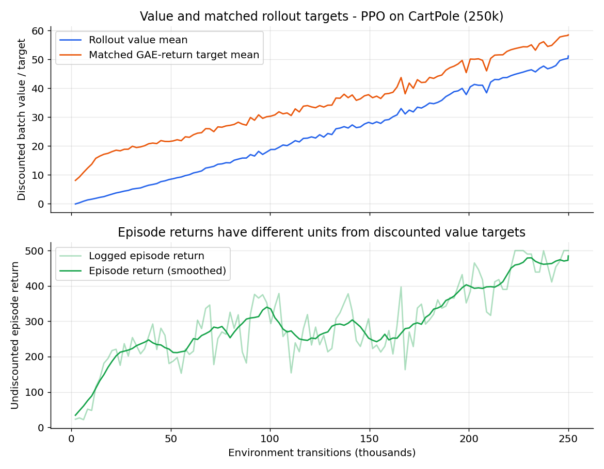
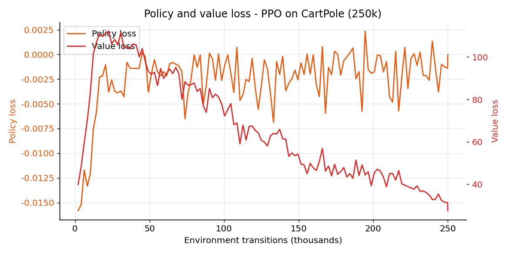
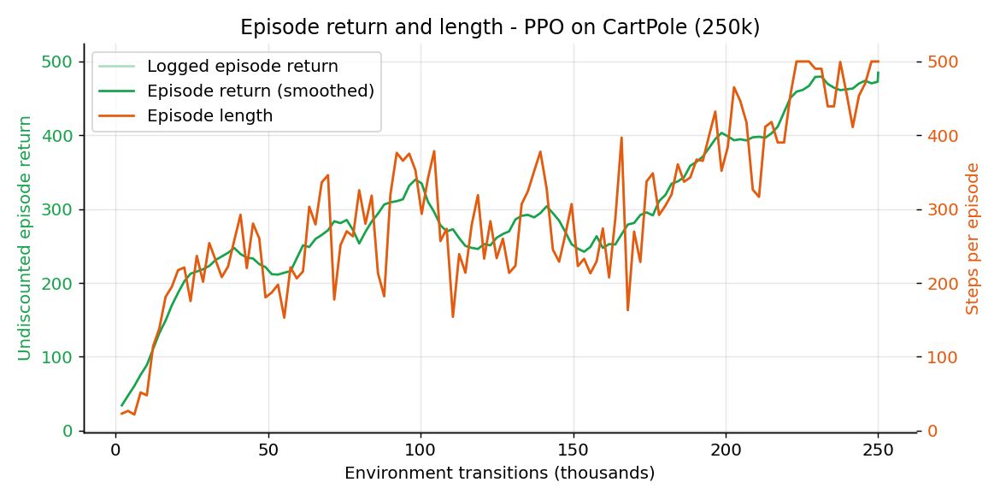

<p align="center">
  
</p>

<p align="center">
  
</p>

# Proximal Policy Optimization (PPO)

## Overview

This package implements discrete-action PPO in PyTorch, from rollout collection
through a clipped actor-critic update. Train with a YAML configuration, inspect
local Weights & Biases (W&B) history, and evaluate the saved `best.pt` policy.
The default example is `CartPole-v1`.

## Highlights

- A categorical actor and scalar value head share a configurable MLP backbone.
- Generalized Advantage Estimation (GAE) uses the done flag for the actual
  transition, not the next transition.
- True termination masks value bootstrapping. Time-limit truncation bootstraps
  from the final observation but stops GAE from crossing into the reset episode.
- Modern Gymnasium vector environments use same-step autoreset, so reset-only
  vector steps are not counted as training transitions.
- Clipped policy and value losses, entropy regularization, minibatch updates,
  gradient clipping, and finite normalization even for singleton minibatches.
- Training samples actions; demo and checkpoint evaluation use argmax by default.
- W&B authentication precedence is CLI key, environment key, then YAML key. Keys
  are excluded from the logged configuration.
- Logging and periodic checkpoint intervals are measured in PPO updates. A final
  partial rollout consumes the configured transition budget exactly.

## What is PPO?

PPO alternates between collecting experience with the current policy and reusing
that on-policy rollout for several optimization epochs. The probability ratio
compares the new policy with the policy that collected the data. Clipping limits
how much a single update can benefit from moving that ratio away from one.
The value head provides a baseline, and GAE balances bias against variance in
advantage estimates. There is no replay buffer or target network in this PPO
implementation.

## The math

Let $r_t$ be a reward, $d_t$ indicate either termination or truncation of
transition $t$, and $z_t$ indicate true termination only. The next observation
$s'_t$ is the pre-reset final observation when a time limit truncates an episode.

### Advantage and return targets

$$
\delta_t = r_t + \gamma (1-z_t)V_{\mathrm{old}}(s'_t) - V_{\mathrm{old}}(s_t)
$$

$$
\hat A_t = \delta_t + \gamma\lambda(1-d_t)\hat A_{t+1}, \qquad \hat A_T = 0
$$

$$
\hat R_t = \hat A_t + V_{\mathrm{old}}(s_t)
$$

The two masks serve different purposes: a timeout retains its bootstrap value,
but neither a timeout nor a terminal transition propagates advantages from the
next episode. At an unfinished rollout boundary, the last transition bootstraps
from the next observation. Advantages are normalized within each minibatch using
population standard deviation and a small numerical epsilon.

### Clipped policy loss

$$
\rho_t(\theta) = \frac{\pi_\theta(a_t\mid s_t)}{\pi_{\mathrm{old}}(a_t\mid s_t)}
$$

$$
L_\pi = -\mathbb E_t\left[\min\left(\rho_t\hat A_t,
\operatorname{clip}(\rho_t,1-\epsilon,1+\epsilon)\hat A_t\right)\right]
$$

### Clipped value loss and entropy

$$
V_t^{\mathrm{clip}} = V_{\mathrm{old}}(s_t) +
\operatorname{clip}\left(V_\theta(s_t)-V_{\mathrm{old}}(s_t),-\epsilon,\epsilon\right)
$$

$$
L_V = \tfrac12\mathbb E_t\left[\max\left(
(V_\theta(s_t)-\hat R_t)^2,(V_t^{\mathrm{clip}}-\hat R_t)^2\right)\right]
$$

$$
L = L_\pi + c_V L_V - c_H\mathbb E_t[\mathcal H(\pi_\theta(\cdot\mid s_t))]
$$

Adam minimizes $L$, with global gradient-norm clipping. The default entropy
coefficient is zero. The logged approximate KL is a squared log-probability-change
diagnostic; a high value produces a warning, not automatic early stopping.

### Algorithm summary

1. Sample categorical actions and store observations, actions, old log
   probabilities, values, rewards, transition-done flags and true terminations.
2. Evaluate next-state values, using final observations for timeouts.
3. Compute GAE and return targets using transition-aligned masks.
4. Shuffle the rollout for each epoch and optimize clipped policy/value losses.
5. Log losses, entropy, KL, value/target diagnostics and completed-episode returns.
6. Save numbered checkpoints and `best.pt` when the last ten completed training
   episodes improve. Evaluate the saved policy on fresh seeds without exploration.

### Symbol-to-code map

| Quantity | Code |
| --- | --- |
| Categorical policy and value | `ActorCritic` in `ppo/networks.py` |
| Transition boundary and true termination | `dones_buf`, `terminations_buf` in `main.py` |
| Pre-reset timeout observation | `_bootstrap_observations` in `main.py` |
| Next-state bootstrap value | `next_values_buf` in `main.py` |
| Advantage and return targets | `PPOAgent.compute_gae` |
| Probability ratio and clipped surrogate | `ratio`, `policy_loss` in `PPOAgent.update` |
| Clipped value loss | `value_clipped`, `value_loss` in `PPOAgent.update` |
| Entropy and gradient clipping | `ent_coef`, `max_grad_norm` |

## Environment

CartPole has four continuous observations and two discrete actions. The policy
must keep the pole balanced and the cart inside the track. Each step earns one
reward; true failure terminates the episode, while the time limit truncates it.

CartPole is retained as the existing PPO benchmark. A3C also has an optional
CartPole configuration for comparisons; its main showcase uses LunarLander.
This shared benchmark is intentional, not a newly selected duplicate environment.
Only flat observations and zero-based discrete actions are supported.

## Quickstart

Run from the repository root. Choose a fresh environment name for each test or
training run; these commands use a dedicated PPO training environment:

```bash
uv venv .venv-ppo-cartpole
source .venv-ppo-cartpole/bin/activate
uv sync --active

WANDB_MODE=offline OMP_NUM_THREADS=1 MKL_NUM_THREADS=1 \
  uv run --active python -m PPO.main train --config PPO/configs/cartpole_tuned.yaml

uv run --active python -m PPO.main demo --config PPO/configs/cartpole_tuned.yaml
```

The default configuration uses CPU because this is a small MLP. Set `device` to
`cuda` or `auto` for a GPU. The thread limits avoid oversubscription on large CPU
hosts. CartPole needs only the classic-control dependencies already declared in
`pyproject.toml`; it does not need Box2D or MuJoCo. PPO supports the legacy
Gymnasium 0.29 vector API and explicit same-step autoreset in Gymnasium 1.1+.
Gymnasium 1.0 is rejected because its reset-only steps violate this transition
contract.

For headless deterministic rollouts:

```bash
uv run --active python -m PPO.main demo --config PPO/configs/cartpole_tuned.yaml \
  --model_path PPO/checkpoints_tuned/best.pt --episodes 10 --seed 1000 --render_mode none
```

Use `--deterministic=False` only when deliberately evaluating a sampled policy.
For online W&B logging, authenticate with `WANDB_API_KEY` or `--wandb_key` and
select the desired W&B mode yourself. The offline mode above writes local history
without uploading; `WANDB_MODE=disabled` does not produce that history.

## Tests

Use another fresh named environment:

```bash
uv venv .venv-ppo-tests
source .venv-ppo-tests/bin/activate
uv sync --active
OMP_NUM_THREADS=1 MKL_NUM_THREADS=1 \
  uv run --active python -m pytest tests/ppo/ -q
```

The suite uses stub environments and mocked W&B, not real training or network
access. Coverage includes terminal/timeout GAE boundaries, deterministic actions,
finite updates, model/optimizer checkpoint round trips, W&B key precedence,
logging cadence, exact step budgets, best-checkpoint selection, demo and cleanup.
Run this directory separately from the other algorithms' suites to avoid their
pre-existing repeated test-module names.

## Configuration

The default CLI recipe is `configs/cartpole_tuned.yaml` (250,000 transitions).
`configs/cartpole.yaml` retains the 100,000-transition baseline for comparison.
Both configurations control:

- Environment ID, seed, vector-environment count and inference rendering.
- Exact transition budget, rollout length, update epochs and minibatch size.
- Learning rate, discount, GAE lambda, clipping range, loss weights and gradient
  clipping. Total transitions must be divisible by `num_envs`.
- Shared hidden-layer sizes and activation.
- W&B project/run name and logging cadence in PPO updates.
- Checkpoint cadence in updates, output directory, best saving and demo defaults.

`best.pt` is selected only after ten completed training episodes. Selection uses
noisy training returns, so deterministic checkpoint evaluation is a separate
check, not a claim that the training-window score is unbiased.

## Training results and analysis

Both recipes were trained from scratch on CPU with training seed 42 and the
same PPO hyperparameters. The baseline uses 100,000 transitions; the recommended
recipe uses 250,000. Every evaluation below loads `best.pt`, uses deterministic
argmax actions, and includes every requested episode without filtering.

| Policy / recipe | Fresh evaluation seeds | Episodes | Mean return +/- population std | Range |
| --- | --- | --- | --- | --- |
| Seeded random actions | 1000-1099 | 100 | 21.87 +/- 9.64 | 10-48 |
| PPO baseline, 100k transitions | 1000-1099 | 100 | 463.54 +/- 67.58 | 267-500 |
| PPO baseline, 100k transitions | 2000-2099 | 100 | 464.49 +/- 61.08 | 291-500 |
| PPO tuned, 250k transitions | 1000-1099 | 100 | 500.00 +/- 0.00 | 500-500 |
| PPO tuned, 250k transitions | 2000-2099 | 100 | 500.00 +/- 0.00 | 500-500 |

The 100k recipe falls below CartPole's 475-return threshold on these held-out
ranges. Extending the transition budget reaches the 500-step limit in all 200
held-out episodes. The selected tuned checkpoint was saved at transition
223,232, when its ten-episode sampled training window first reached 500.
The full training run still completed all 250,000 transitions.

Training-window scores and deterministic evaluation are different measurements.
For example, the baseline's best sampled training window was 376.20 even though
its fresh-seed greedy evaluation averaged about 464. Do not infer greedy-policy
quality from a small noisy training window alone. The longer run's final training
window also reached 500.

These are two evaluation seed ranges for one training seed, not evidence across
multiple independent training seeds. The tuned comparison also uses more data,
so it is not an isolated causal estimate of the GAE fix. The charts below come
from the tuned run's 123 logged update points. Raw per-episode evaluation,
checkpoint metadata, and training summaries live under `PPO/logs/`; local W&B
runs retain the full metric history.

A fresh-environment validation passed **65 tests and 28 subtests**. The headless
CLI demo and the real evaluation/chart/GIF helpers were also exercised; the
unit tests themselves use stubs.

## Reproduce evaluation and assets

The evaluation helper reports all episodes, saves individual returns/seeds and
checkpoint metadata, and logs a separate offline W&B evaluation run:

```bash
uv run --active python -m PPO.utils.evaluate \
  --config PPO/configs/cartpole_tuned.yaml --checkpoint PPO/checkpoints_tuned/best.pt \
  --episodes 100 --seed 1000 --out PPO/logs/evaluation.json

uv run --active python -m PPO.utils.evaluate \
  --config PPO/configs/cartpole_tuned.yaml --random \
  --episodes 100 --seed 1000 --out PPO/logs/random-baseline.json

SDL_VIDEODRIVER=dummy uv run --active python -m PPO.utils.make_gif \
  --config PPO/configs/cartpole_tuned.yaml --checkpoint PPO/checkpoints_tuned/best.pt \
  --out PPO/assets/ppo_cartpole.gif

uv run --active python -m PPO.utils.make_charts \
  --run wandb/<offline-run>/run-<id>.wandb --out-dir PPO/assets \
  --title "PPO on CartPole" --summary PPO/logs/training-summary.json
```

The GIF selects the top three of eight deterministic showcase episodes. It is
not the evaluation mean. See `utils/README.md` for wrappers and argument details.
Checkpoints and logs are ignored; regenerated PNG/GIF assets belong in the PR.

## Training charts

<p align="center">
  
</p>

Value predictions and discounted GAE-return targets are compared on the same
rollout batches. The separate return panel is undiscounted. Comparing their raw
means would not establish value calibration.

<p align="center">
  
</p>

Policy and clipped value loss are averaged over the update minibatches. A small
policy loss alone does not certify a good policy; use fresh-seed return evaluation.

<p align="center">
  
</p>

The training return and length curves are rolling means of ten completed
sampling-policy episodes, not deterministic evaluation scores.

## References

- Schulman et al., [Proximal Policy Optimization Algorithms](https://arxiv.org/abs/1707.06347).
- Schulman et al., [High-Dimensional Continuous Control Using Generalized Advantage Estimation](https://arxiv.org/abs/1506.02438).
- [Gymnasium CartPole](https://gymnasium.farama.org/environments/classic_control/cart_pole/).
