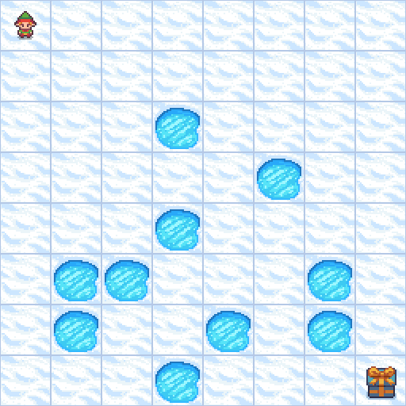
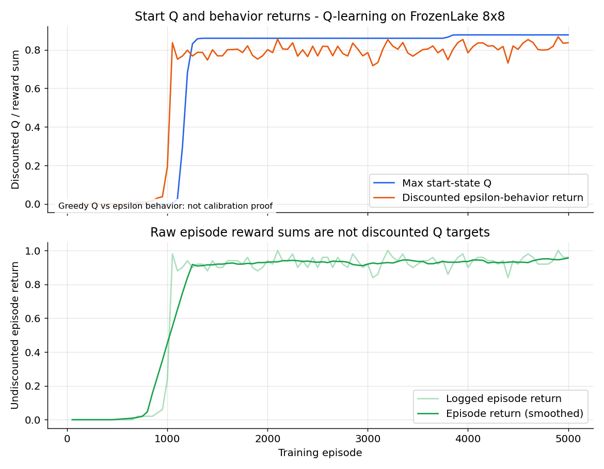
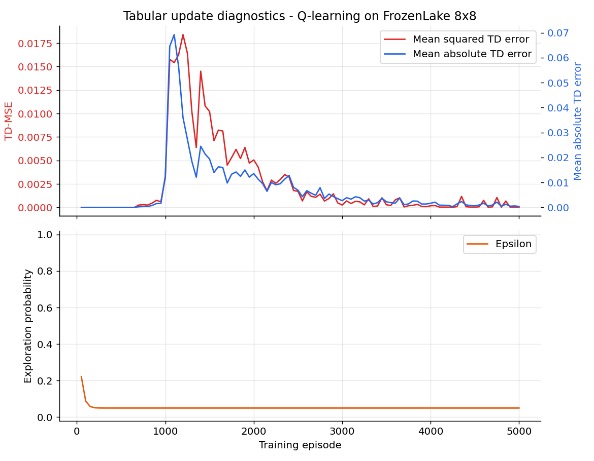
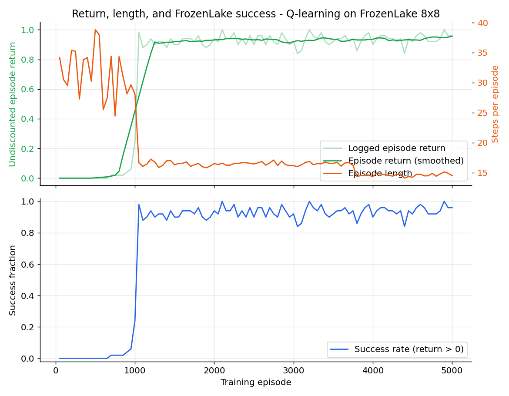

<p align="center">
  
</p>

<p align="center">
  
</p>

# Tabular Q-learning

## Overview

Learn a table of action values from experience, without a neural network or an
RL framework. The default example is deterministic `FrozenLake-v1` on the 8x8
map. A YAML config drives a Fire `train`/`demo` CLI, local W&B metrics, and
best/numbered Q-table checkpoints.

## Highlights

- A NumPy Q-table with one row per discrete state and one column per action.
- Epsilon-greedy training with exponential step-based exploration decay and
  random tie-breaking among maximal actions.
- Deterministic evaluation uses the first argmax action, without consuming RNG
  or advancing the training exploration counter.
- True termination suppresses value bootstrapping. Environment truncation and
  the configured episode step cap end interaction but retain the bootstrap.
- Exact tabular TD updates return finite diagnostics; invalid dimensions,
  indices, hyperparameters and checkpoint tables are rejected.
- W&B key precedence is CLI, environment, then YAML. Keys are excluded from
  logged/saved public configuration.
- Checkpoints preserve the Q-table, episode metadata and training action counter.
- Train/demo close environments reliably; training also finishes its W&B run on
  failures. Logging and numbered checkpoints include the final episode.

## What is Q-learning?

Q-learning is model-free, off-policy reinforcement learning. Its table estimates
how much discounted reward each action can obtain from a state. After one
transition, it moves the selected table entry toward the observed reward plus
the best estimated next-state value. The behavior policy explores, but the
bootstrap target is greedy, which makes the update off-policy.

There is no actor, critic network, target network, optimizer or replay buffer in
this tabular implementation. PyTorch is used only for checkpoint serialization.
The Q-table and learning updates run on CPU.

## The math

Let $z_t=1$ only for true termination of transition $t$. A time limit or external
step cap is not a terminal state of the underlying task.

$$
y_t = r_t + \gamma(1-z_t)\max_{a'} Q_t(s_{t+1},a')
$$

$$
\delta_t = y_t - Q_t(s_t,a_t)
$$

$$
Q_{t+1}(s_t,a_t) = Q_t(s_t,a_t) + \alpha\delta_t
$$

Only that state/action entry changes. The reported squared TD residual is
$\delta_t^2$ before the update, not a neural-network or actor loss.

The exploration schedule is:

$$
\varepsilon_t = \varepsilon_{\mathrm{end}} +
(\varepsilon_{\mathrm{start}}-\varepsilon_{\mathrm{end}})
\exp(-kt)
$$

Here $t$ is the number of training action selections, advanced before each
behavior action, and $k$ is `epsilon_decay`. With probability $\varepsilon_t$
the agent chooses a uniformly random action. Otherwise it selects uniformly
among actions tied for the largest Q-value. Demo/evaluation uses fixed argmax
instead, so a tied table is repeatable and the training counter is unchanged.

For value diagnostics:

$$
V_Q(s_0)=\max_a Q(s_0,a), \qquad
G_0=\sum_{t=0}^{L-1}\gamma^t r_t
$$

The training chart compares the start-state Q estimate with the discounted
return collected by the epsilon-greedy behavior policy. They use discounted
units, but they describe different policies, so matching their means would not
prove calibration. Evaluation separately records greedy discounted returns.

### Algorithm summary

1. Initialize a zero Q-table and seed the environment and action RNG.
2. Reset an episode, select an epsilon-greedy action, and observe a transition.
3. Apply the termination-masked TD update to one table entry.
4. Repeat until termination, environment truncation, or the configured step cap.
5. Log episode returns/lengths, exploration, start-state values and TD residuals.
6. Save numbered checkpoints and the table whose completed-episode rolling
   training return improves; evaluate `best.pt` separately with greedy actions.

### Symbol-to-code map

| Quantity | Code |
| --- | --- |
| Action-value table | `QLearningAgent.Q` |
| Transition and terminal mask | `Transition`, with `done=terminated` in `main.py` |
| TD target, residual and updated value | `QLearningStats` from `QLearningAgent.update` |
| Learning rate and discount | `alpha`, `gamma` |
| Exploration probability | `QLearningAgent.epsilon` |
| Training selection count | `global_step` |
| Deterministic policy | `QLearningAgent.act(..., deterministic=True)` |
| Best completed-episode window | `best_window` in the YAML config |

## Environment

The default 8x8 FrozenLake map has 64 discrete state IDs and four actions. The
agent must reach the goal while avoiding holes. The goal transition earns 1;
other rewards are zero, so positive episode return is success for this benchmark.
`is_slippery: false` makes transitions deterministic. Both state and action
spaces must be zero-based `Discrete` spaces.

The configured interaction cap is 200 steps per episode. A cap or Gymnasium
time limit stops that rollout without pretending the next state is terminal.
Reset seeds do not randomize the fixed map or its start state. Repeated success
on this map is not evidence of generalization to other maps or slippery dynamics.
FrozenLake's positive-return fraction is reported as success for this benchmark;
other environments receive a generic positive-return metric, not an inferred
success rate.
If experimenting with other discrete environments, interpret their task-specific
success conditions explicitly.

## Quickstart

From the repository root, create a fresh named environment for the training run:

```bash
uv venv .venv-qlearning-train
source .venv-qlearning-train/bin/activate
uv sync --active

WANDB_MODE=offline OMP_NUM_THREADS=1 MKL_NUM_THREADS=1 \
  uv run --active python -m Qlearning.main train \
  --config Qlearning/configs/frozenlake.yaml

uv run --active python -m Qlearning.main demo --episodes 5
```

The default demo is headless. Request terminal frames or a local window explicitly:

```bash
uv run --active python -m Qlearning.main demo --render_mode ansi --episodes 1
uv run --active python -m Qlearning.main demo --render True --episodes 1
```

`--render_mode none` explicitly disables rendering. The legacy `--render True`
flag selects human rendering; an explicit render-mode override takes precedence.
Box2D or MuJoCo are not needed for this toy-text learner; the existing
project dependency list covers its training, checkpointing and GIF/chart tools.

For W&B cloud logging, authenticate and choose online mode yourself. The example
uses `WANDB_MODE=offline`, which keeps a local history without uploading. Disabled
mode does not create the metric history needed by the chart helper.

## Tests

Use a separate fresh environment:

```bash
uv venv .venv-qlearning-tests
source .venv-qlearning-tests/bin/activate
uv sync --active
OMP_NUM_THREADS=1 MKL_NUM_THREADS=1 \
  uv run --active python -m pytest tests/qlearning/ -q
```

The suite uses stub environments and mocked W&B rather than real training or
network access. It covers exact TD arithmetic, terminal/cutoff behavior, action
selection and RNG/counter semantics, table persistence, configuration validation,
W&B precedence/redaction, logging/checkpoints, demos, cleanup and helper behavior.
A fresh-environment run passed **78 tests and 111 subtests** with warnings treated
as errors. Real headless and ANSI demos, unfiltered checkpoint/random evaluations,
and chart/GIF generation were also exercised. The unit suite itself uses stubs.
Run this directory separately from the other algorithms' test suites.

## Configuration

`configs/frozenlake.yaml` exposes:

- Environment ID, map/slipperiness kwargs, seed and default rendering.
- Episode budget and maximum interaction steps per episode.
- Learning rate, discount and step-based epsilon schedule.
- Logging/checkpoint intervals in episodes, output paths and `best_window`.
- Inference checkpoint and demo episode count.

The tabular learner uses CPU; `device: auto` is accepted and also resolves to CPU.
`best.pt` is selected from a rolling window of completed training episodes, not
from a held-out evaluation. Model parameters and exploration state are copied on
restoration. Checkpoints do not claim to restore every environment/RNG state for
bit-identical training resumption.

## Training results and analysis

Training used the unchanged 5,000-episode FrozenLake recipe, training seed 42,
learning rate 0.1 and discount 0.99 on CPU. The full run completed all episodes.
The selected `best.pt` was saved at episode 1,011, when its ten-episode training
window first reached mean return 1.0.

Every checkpoint evaluation below uses fixed argmax actions, includes every
requested episode, and uses reset seeds outside the training range 42-5041.

| Policy | Reset seeds | Episodes | Mean return +/- population std | Success | Mean length |
| --- | --- | --- | --- | --- | --- |
| Seeded random actions | 10000-10999 | 1000 | 0.0030 +/- 0.0547 | 3/1000 (0.3%) | 30.01 |
| Untouched stock control | 10000-10099 | 100 | 1.0000 +/- 0.0000 | 100/100 | 16 |
| Updated Q-learning `best.pt` | 10000-10099 | 100 | 1.0000 +/- 0.0000 | 100/100 | 16 |
| Updated Q-learning `best.pt` | 20000-20099 | 100 | 1.0000 +/- 0.0000 | 100/100 | 16 |

The updated policy reached the goal in all 200 same-map evaluations, following
a 16-step path with discounted return about 0.86006. The stock control matched
this score and route; the correctness/tests/tooling changes are not presented as
a measured performance improvement over that control.

The final logged training window achieved mean return 0.96 with residual epsilon
0.05. That sampled behavior score differs from greedy evaluation: exploratory
actions can lead into holes even when the greedy route is reliable. Small TD
errors on experienced transitions and success on this map do not establish
complete state coverage or convergence of every Q entry.

`best.pt` is selected by raw training return, not route length or discounted
value. A successful route is therefore not automatically the shortest route,
and a first perfect training window is not evidence that the whole Q-table has
converged. The regenerated charts come from the full training run's 100 logging
points, while the GIF loads the selected checkpoint.

These reset ranges are nominally held out, but this deterministic map always
starts in the same cell. The 200 repetitions do not represent independent maps,
training seeds or stochastic transition conditions. The random baseline includes
both successful and failed episodes; the GIF remains only a selected showcase.
Raw evaluation JSON, checkpoint metadata and training summaries are saved under
`Qlearning/logs/`, and the offline W&B run preserves the complete metric history.

## Reproduce evaluation and assets

The evaluator includes every episode, records seeds/returns/lengths, and writes
an offline W&B run plus a JSON report:

```bash
uv run --active python -m Qlearning.utils.evaluate \
  --config Qlearning/configs/frozenlake.yaml --episodes 100 --seed 10000 \
  --out Qlearning/logs/evaluation.json

uv run --active python -m Qlearning.utils.evaluate \
  --config Qlearning/configs/frozenlake.yaml --random --episodes 100 --seed 10000 \
  --out Qlearning/logs/random-baseline.json

SDL_VIDEODRIVER=dummy uv run --active python -m Qlearning.utils.make_gif \
  --config Qlearning/configs/frozenlake.yaml \
  --out Qlearning/assets/qlearning_frozenlake_8x8.gif

uv run --active python -m Qlearning.utils.make_charts \
  --run wandb/<offline-run>/run-<id>.wandb --out-dir Qlearning/assets \
  --title "Q-learning on FrozenLake 8x8" --summary Qlearning/logs/training-summary.json
```

Checkpoint defaults are inferred from the selected config. The GIF is a selected
showcase, not the reported evaluation mean. See `utils/README.md` for wrappers,
arguments and metric interpretation. Checkpoints and raw logs are ignored; source,
tests, docs and PNG/GIF assets are the reviewable files.

## Training charts

<p align="center">
  
</p>

The discounted quantities are separated from undiscounted returns; the behavior
policy differs from the greedy Q-learning target policy.

<p align="center">
  
</p>

TD residuals describe the tabular update, not a neural-network loss. Exploration
is shown separately so a small residual on frequently visited states is not
mistaken for comprehensive coverage or a good policy.

<p align="center">
  
</p>

Episode summaries use the configured logging window. Deterministic checkpoint
results are measured separately, without filtering away failures.

## References

- Watkins and Dayan, [Q-learning](https://www.gatsby.ucl.ac.uk/~dayan/papers/cjch.pdf).
- Sutton and Barto, [Reinforcement Learning: An Introduction](https://www.andrew.cmu.edu/course/10-703/textbook/BartoSutton.pdf).
- [Gymnasium FrozenLake](https://gymnasium.farama.org/environments/toy_text/frozen_lake/).
