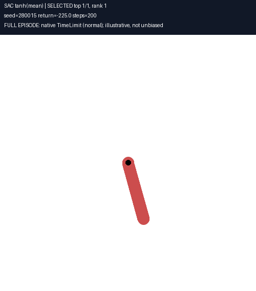
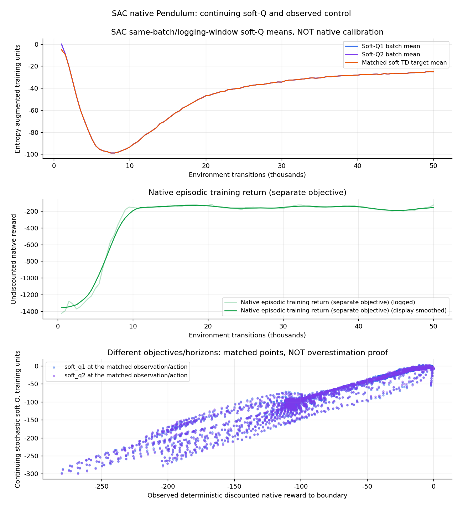
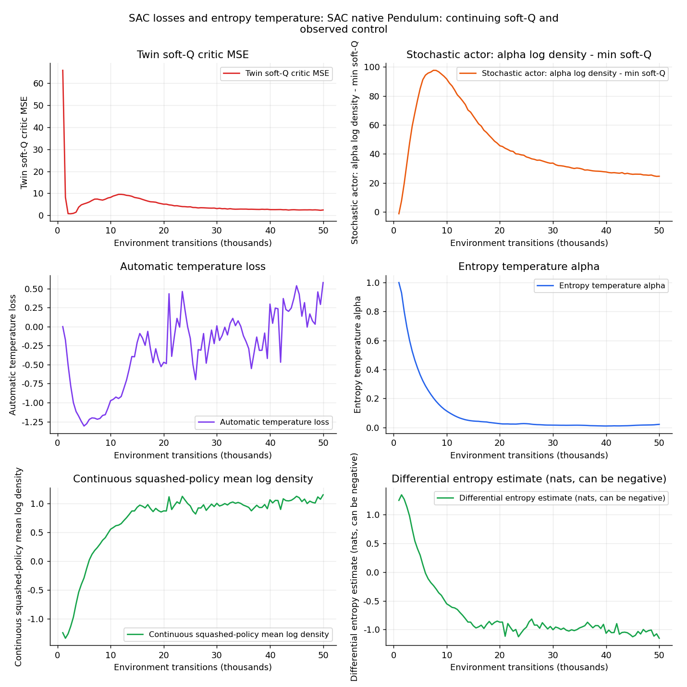
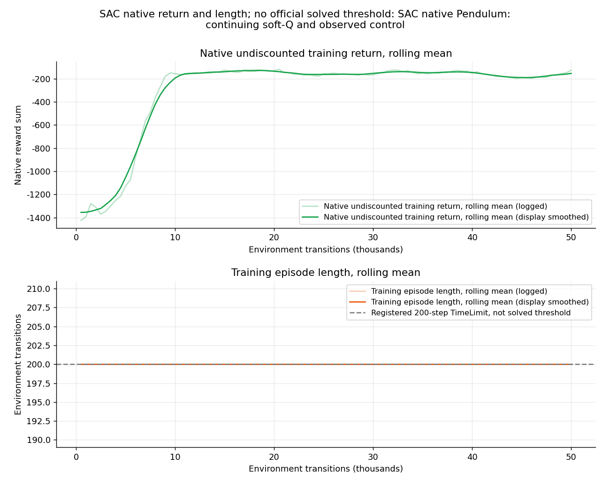

<p align="center"></p>

# Soft Actor-Critic (SAC)

<p align="center"></p>

## Overview

SAC is an off-policy continuous-control actor-critic algorithm. A stochastic
squashed Gaussian actor learns alongside twin Q critics, target critics, and an
automatically tuned entropy temperature. Replay samples are reused for learning.

The default CLI recipe is the bounded50k-step CPU profile in
`configs/pendulum_fast.yaml`. Its frozen checkpoint averaged **-164.82 +/-83.61
native return across200 independent200-step episodes**. The final20 observations
met the stated settling diagnostic in every episode. Pendulum has **no official
solved threshold**; this is measured behavior, not a universal success guarantee.
The GIF shows a full natural near-hanging-down start, swing-up, and upright hold.

## Highlights

- Physical-action log density includes both action-scale and stable tanh
  Jacobians. The original affine scale correction is preserved.
- Finite ordered action bounds, tensor shapes, activation/layer validation,
  single/batched actions, and deterministic mean inference without sampling RNG.
- No target-critic gradients. Online critic parameters are temporarily frozen
  during actor optimization, retaining gradients through the sampled action.
- Temperature is detached from actor loss; loading preserves the existing
  `log_alpha` Parameter and its optimizer reference.
- Finite losses/gradients/norms before each Adam phase. Defensive rollback is
  **phase-local**, not a transaction across all three sequential updates.
- Replay validates complete inputs before mutation and owns float32 copies.
  Invalid terminal masks, bounds, empty batches, and unsafe casts are rejected.
- True terminals suppress bootstrap. Native truncations retain the continuing
  soft-value bootstrap from the actual endpoint, not a reset observation.
- Manual caps are reported separately and do not become completed native
  episodes for best-window selection.
- Owned checkpoint snapshots, atomic replacement, metadata/credential validation,
  distinct targets and optimizer state, and safe partial-state compatibility.
- Installed SAC imports work outside the repository root; optional evaluation,
  full-span GIF, and offline W&B chart helpers are included.

## What is SAC?

The actor optimizes a maximum-entropy return rather than only expected native
reward. Twin critics reduce optimistic targets by taking their minimum. Target
critics change slowly through Polyak averaging. Temperature balances reward and
entropy and is learned from the policy's log density.

Greedy deployment uses the tanh-transformed Gaussian mean. Its native200-step
reward is a different objective and horizon from a stochastic continuing soft Q.
Do not interpret soft-Q versus observed native reward as direct calibration or
proof of overestimation without accounting for those differences.

## The math

### Entropy-augmented objective

$$
J(\pi)=\mathbb E_\pi\left[\sum_{t\ge0}\gamma^t
(r_t+\alpha\mathcal H(\pi(\cdot\mid s_t)))\right],\qquad
\mathcal H=-\mathbb E_{a\sim\pi}[\log\pi(a\mid s)]
$$

### Squashed Gaussian in physical action units

$$
z=\mu_\theta(s)+\sigma_\theta(s)\odot\epsilon,\quad
\epsilon\sim\mathcal N(0,I),\qquad a=b+c\odot\tanh(z)
$$

Here $c=(a_{\max}-a_{\min})/2$ and $b=(a_{\max}+a_{\min})/2$.

$$
\log\pi_\theta(a\mid s)=\sum_j\left[
\log\mathcal N(z_j;\mu_j,\sigma_j)-\log c_j
-2(\log2-z_j-\operatorname{softplus}(-2z_j))\right]
$$

The stable expression is the exact log tanh Jacobian, avoiding an epsilon
approximation at saturated actions. Differential entropy/log density can be
negative/positive; it is not a categorical probability or a0-to1 score.

### Twin critics

Let $z_t^{\mathrm{term}}$ indicate **true termination**, not a time limit.

$$
y_t=r_t+\gamma(1-z_t^{\mathrm{term}})\left[
\min_iQ_{\bar\phi_i}(s_{t+1},a_{t+1})-\alpha\log\pi_\theta(a_{t+1}\mid s_{t+1})
\right]
$$

$$
L_Q=\mathbb E_{\mathcal D}\left[
(Q_{\phi_1}(s_t,a_t)-y_t)^2+(Q_{\phi_2}(s_t,a_t)-y_t)^2\right]
$$

The next action and target are computed without gradients. Native Pendulum's
200-step TimeLimit is a truncation; the actual endpoint is retained for bootstrap.

### Actor and temperature

$$
L_\pi=\mathbb E_{s\sim\mathcal D,a\sim\pi_\theta}
[\operatorname{stopgrad}(\alpha)\log\pi_\theta(a\mid s)-\min_iQ_{\phi_i}(s,a)]
$$

$$
L_\alpha=-\mathbb E\left[\log\alpha\,
\operatorname{stopgrad}(\log\pi_\theta(a\mid s)+\mathcal H_{\mathrm{target}})\right],
\qquad\mathcal H_{\mathrm{target}}=-d_a\eta
$$

The target is defined in the implemented physical-action density units; action
scaling is not silently removed from the log density. `target_entropy_scale`
controls $\eta$. Actor, critic, and temperature Adam phases remain sequential.

$$
\bar\phi_i\leftarrow\tau\phi_i+(1-\tau)\bar\phi_i
$$

### Algorithm summary

1. Seed model/environment/action spaces and inspect flat continuous spaces.
2. Collect random actions for `start_steps`, then sample the learned policy.
3. Store owned transitions with a true-terminal-only mask and actual endpoint.
4. After `update_after` and sufficient replay, sample batches with replacement.
5. Update critics, actor, and temperature with finite checks; soft-update targets.
6. Log losses, soft-Q diagnostics, native completed episodes, and update counts.
7. Save only genuine completed-episode best windows, then evaluate all requested
   fresh episodes and inspect a full-span deployment demonstration.

| Quantity | Code |
| --- | --- |
| Policy and physical log density | `GaussianPolicy.sample`, `deterministic` |
| Twin and target Q networks | `QNetwork`, `SACAgent.q1/q2/q1_target/q2_target` |
| Temperature and target entropy | `log_alpha`, `alpha`, `target_entropy` |
| Replay and true-terminal mask | `ReplayBuffer`, `main.train` |
| Sequential losses/target update | `SACAgent.update`, `_soft_update` |
| Owned model/Adam snapshot | `state_dict`, `save_checkpoint`, `load_checkpoint` |
| Native complete inference | `utils.evaluate`, `utils.make_gif` |

## Environment and diagnostics

Default native `Pendulum-v1` has3 features (cosine, sine, angular velocity), one
bounded torque action in[-2,2], gravity10, and a200-step horizon. The native reward
penalizes angle, angular velocity, and torque. More nearly upright, low-velocity
control yields returns closer to zero. Native timestep0.05 means10 simulated
seconds per200-step episode.

`env_kwargs` forwards valid Gym constructor arguments; native Pendulum exposes
`g`, not constructor arguments for `max_speed`, `max_torque`, or `dt`. Native
helpers retain stock gravity and horizon. No reward shaping, teacher controller,
extra actor information, or goal modification is used in reported evaluations.

The observer settling diagnostic is **all last20 post-transition states within
|wrapped angle|<=0.1 rad and |angular velocity|<=0.5 rad/s**. It is a1-second final
snapshot, not an official success flag or lasting-stability proof. Native
TimeLimit truncation is normal and must not be described as200 failures.

## Quickstart

From the repository root, create a new custom environment for each run:

```bash
export UV_PROJECT_ENVIRONMENT="$PWD/.venv-sac-training"
uv venv "$UV_PROJECT_ENVIRONMENT"
uv sync --locked
WANDB_MODE=offline OMP_NUM_THREADS=1 MKL_NUM_THREADS=1 \
  uv run python -m SAC.main train --config SAC/configs/pendulum_fast.yaml
```

The original200k-step256-layer recipe remains in `configs/pendulum.yaml` for
comparison. The bounded50k profile uses128 layers and batch128 with1k random and
learning warm-up. It changes capacity/batch/budget/warm-up/clipping as well as the
correctness fixes; this is not an isolated causal ablation.

In a separate fresh environment:

```bash
uv run python -m SAC.main demo --episodes 5 --render_mode human
# Default null render mode is headless; --render_mode none is explicit.
```

Default checkpoint follows the selected config, normally
`SAC/checkpoints_fast/best.pt`. Checkpoints/raw logs are intentionally ignored;
use the supplied trusted model or train it locally. CLI W&B key overrides
`WANDB_API_KEY`, then YAML key. Logged config and checkpoint metadata exclude
credentials. Examples enable offline W&B without cloud synchronization.

## Configuration and persistence

- `start_steps` controls random-action collection. `update_after` independently
  controls learning eligibility and defaults to `start_steps`; an explicit0
  reproduces the old early-update mode. The old recipe updated as soon as replay
  could sample even while collecting random actions.
- `best_window` is both the native completed-episode minimum and score window.
  It is a sampled training selection, not a held-out or official solved result.
- `max_steps_per_episode` is an explicit safety cap; artificial caps are counted
  separately and never become native completed-episode best scores.
- `global_step` inside the agent counts completed SAC updates. Environment steps
  and update counts are logged/saved separately.
- `max_grad_norm: 0` disables clipping but still checks norms. Each optimizer
  phase verifies finite data; a failing later phase does not promise rollback of
  an already completed earlier phase.

Snapshots own CPU tensor copies. Loading preserves distinct targets and existing
optimizer/temperature identities. Legacy snapshots missing target states fall
back to online critics explicitly. Restoring models/Adam is not exact process
resumption: replay, environment, and RNG state are not checkpointed.

## Verified training and evaluation

The frozen50k-profile checkpoint at environment step20,400, selected by a
sampled20-episode window, was evaluated without filtering any episode:

| Model / reset range | Episodes | Native mean +/- population std | Full200-step episodes |
| --- | --- | --- | --- |
| Untouched stock50k snapshot,180000-180099 |100|-158.05 +/-81.42|100|
|50k profile,180000-180099 |100|-161.51 +/-86.96|100|
| Same frozen model,280000-280099 |100|-168.14 +/-80.00|100|
|50k profile combined |200|-164.82 +/-83.61|200|

Every evaluated episode met the stated final-window settling diagnostic, with no
action bounds violations or added diagnostic caps. Average upright time under
that diagnostic was about8.07 of10 simulated seconds. These are same-dynamics
reset evaluations of one related training run, not independent training-seed
robustness evidence. The small difference from the stock50k score is not proof
that correctness fixes improved native return.

The nominal200k stock control was intentionally stopped after its immutable50k
comparison snapshot and matched-budget evaluation were complete. Its remaining
configured budget was not completed; no full200k result is claimed. Original
source/config, generated snapshots, and raw log remain available separately.

The GIF deliberately illustrates a natural near-hanging-down reset (seed280015,
initial angle-2.8717rad) rather than an easy already-upright start. It includes all
200 transitions and holds upright late in the trajectory, ending at angle0.0459rad
and velocity0.0052rad/s. Its native return is-224.97. Selection is an illustration,
not a filtered aggregate success estimate. The same raw episode remains in the
independent evaluation data.

## Tests, evaluation, and asset tools

The strict fresh-environment suite passed **80 tests and220 subtests** with
warnings as errors. Unit cases use stub environments and mocked W&B. Real native
learning smoke, complete training, isolated installed imports, and full native
inference are additional hardware checks.

```bash
OMP_NUM_THREADS=1 MKL_NUM_THREADS=1 WANDB_MODE=offline \
  uv run python -m pytest tests/sac/ -q -W error

uv run python -m SAC.utils.evaluate --episodes 100 --seed 180000 \
  --out SAC/logs/native-evaluation.json

SDL_VIDEODRIVER=dummy uv run python -m SAC.utils.make_gif \
  --episodes 1 --keep-top 1 --seed 280015 --out SAC/assets/sac_pendulum.gif

uv run python -m SAC.utils.make_charts \
  --config SAC/configs/pendulum_fast.yaml \
  --run wandb/<offline-run>/run-<id>.wandb \
  --evaluation SAC/logs/native-evaluation.json \
  --summary SAC/logs/training-summary.json
```

See [helpers](utils/README.md) for complete trajectory JSON, conservative native
diagnostics, provenance, read-only checkpoints, and selected media. GIF metadata
reports submitted and encoded frames separately and preserves playback duration.
Independent actual pixel review confirmed full swing-up and upright holding.

## Training charts

<p align="center"></p>

Soft Q includes future entropy and continuing bootstrap beyond a native TimeLimit.
Finite-horizon greedy native return has a different objective/horizon; matched
points do not alone establish calibration or overestimation.

<p align="center"></p>

Differential entropy/log density can be negative/positive. These are not copied
categorical probabilities or unrelated algorithm loss labels.

<p align="center"></p>

Charts come from the50k run's100 logging rows. No native zero-return/length curves
are invented before an episode completes. Low loss and high sampled windows are
not independent policy-quality guarantees.

## References

- Haarnoja et al., [Soft Actor-Critic](https://arxiv.org/abs/1801.01290).
- Haarnoja et al., [Soft Actor-Critic Algorithms and Applications](https://arxiv.org/abs/1812.05905).
- [Gymnasium Pendulum](https://gymnasium.farama.org/environments/classic_control/pendulum/).
