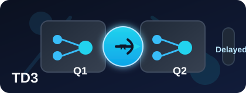
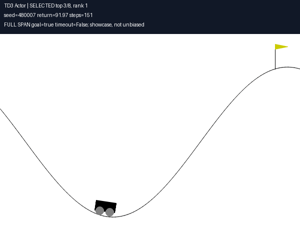
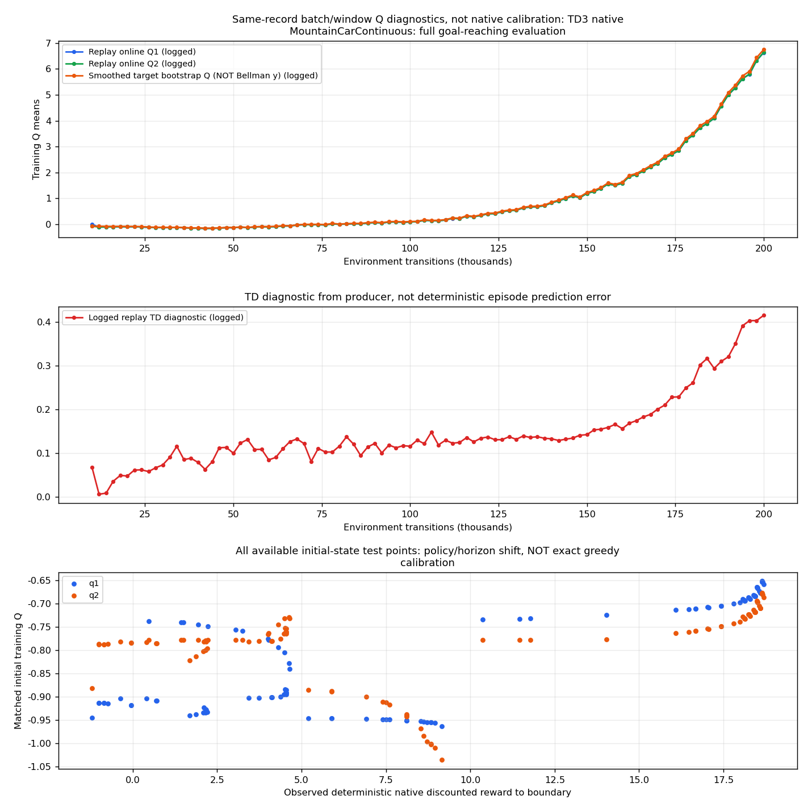
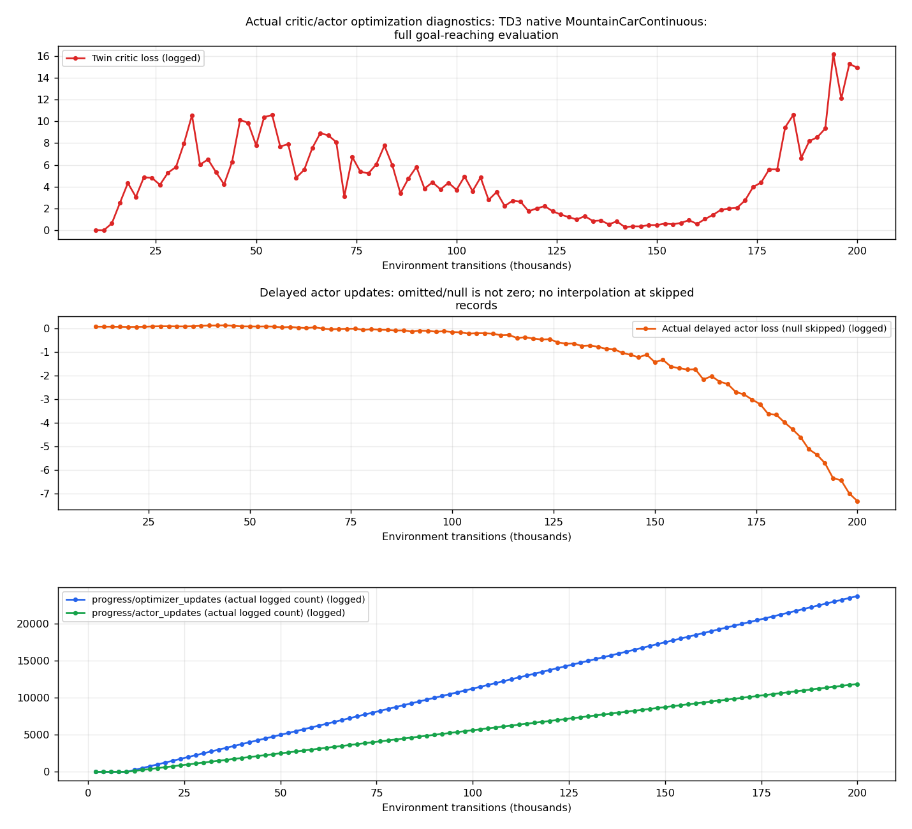
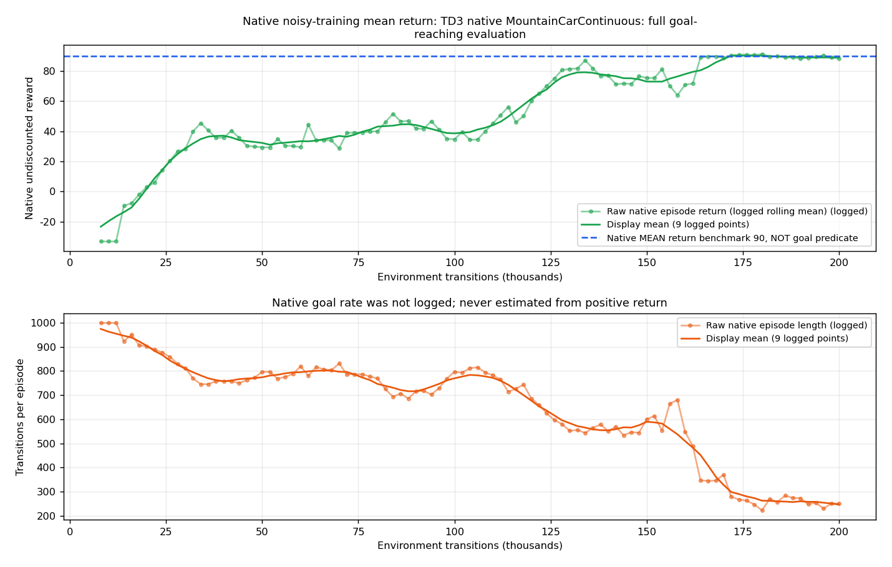

<p align="center"></p>

# Twin Delayed DDPG (TD3)

<p align="center"></p>

## Overview

TD3 is an off-policy continuous-control algorithm with twin critics, delayed
actor/target updates, and clipped target-policy smoothing. The actor is
 deterministic; replay and exploration supply its training data.

The default balanced profile's frozen checkpoint reached **200/200 native goals**
in two independent100-episode ranges, without inference exploration or timeouts.
Mean return was **89.64 +/-2.43**, slightly below the separate90 mean-return
benchmark. Physical goal completion and that benchmark are different claims.
This is one training-seed result, not a universal guarantee.

## Highlights

- Twin-min bootstrap targets, Q1 actor objective, and delayed actor **and all
  target-network updates**. These TD3 features were present and are preserved.
- Physical-unit Gaussian exploration and clipped target noise remain separate.
- Frozen target parameters and critic-parameter isolation during actor gradients,
  while retaining gradients from Q through the actor's action.
- Finite losses/gradients/norms, validated shapes/bounds/scalars, and no silent
  clamping of invalid hyperparameters or action ranges.
- Replay validation before mutation, copied input/sample data, and batched ring
  writes equivalent to sequential insertion even across multiple capacity wraps.
- SAME_STEP actual endpoint observations for terminal/timeout replay. Only true
  termination suppresses bootstrap; reset observations never replace endpoints.
- Exact vector budgets, staggered seeds, manual native episode accounting, pulse
  reset at boundaries, and independent warm-up/learning eligibility.
- Owned CPU model/Adam snapshots, atomic file replacement, prevalidated restores,
  preserved distinct targets, and explicit environment/update counters.
- Native full-episode evaluation, complete selected GIFs, honest offline W&B
  charts, and config-driven checkpoint defaults.

## What is TD3?

TD3 improves deterministic actor-critic learning with three ideas: take the
minimum of two target critics, update the policy less often than critics, and
smooth next-state targets with clipped Gaussian action noise. There is no entropy
objective or temperature learner. Training actions can include exploration noise
and held random pulses; **deployment uses the learned actor alone**.

Vector environments increase data throughput, but do not automatically increase
learning. `updates_per_step` means updates per **vector step**. The original64-env
recipe gives about1/64 update per collected transition; the balanced8-env profile
gives1/8, before accounting for warm-up. These ratios are logged explicitly.

## The math

Let $z_t$ be true termination, not time-limit truncation.

### Actor and target smoothing

$$
\mu_\phi(s)=b+c\odot\tanh(f_\phi(s)),\qquad
c=(a_{\max}-a_{\min})/2,\quad b=(a_{\max}+a_{\min})/2
$$

$$
\epsilon=\operatorname{clip}(\varepsilon,-c_n,c_n),\quad
\varepsilon\sim\mathcal N(0,\sigma_{\mathrm{target}}^2),\qquad
\tilde a'=\operatorname{clip}(\mu_{\bar\phi}(s')+\epsilon,a_{\min},a_{\max})
$$

Noise standard deviation and clipping are in physical action units. `noise_clip`
is $c_n$, distinct from the actor's action scale $c$.

### Twin critics

$$
y_t=r_t+\gamma(1-z_t)\min_{i\in\{1,2\}}Q_{\bar\theta_i}(s'_t,\tilde a'_t)
$$

$$
L_Q=\mathbb E_{\mathcal D}[(Q_{\theta_1}(s,a)-y)^2+(Q_{\theta_2}(s,a)-y)^2]
$$

Rewards and masks become column tensors before forming the target, preventing
accidental batch-by-batch broadcasting. Target computation uses no gradients.
A native timeout retains bootstrap at the actual endpoint, while true
termination zeros it.

### Delayed actor and targets

Every `policy_delay` successful critic updates:

$$
L_\pi=-\mathbb E_{s\sim\mathcal D}[Q_{\theta_1}(s,\mu_\phi(s))]
$$

$$
\nabla_\phi L_\pi=-\mathbb E[\nabla_aQ_{\theta_1}(s,a)\vert_{a=\mu_\phi(s)}
\nabla_\phi\mu_\phi(s)]
$$

$$
\bar\theta_i\leftarrow\tau\theta_i+(1-\tau)\bar\theta_i,\qquad
\bar\phi\leftarrow\tau\phi+(1-\tau)\bar\phi
$$

Both actor and target updates are delayed. Actor loss is absent on other updates,
not recorded as a fabricated zero. Adam phases are sequential, not an all-update
transaction: if a later actor phase fails, an earlier completed critic step
remains counted. Invalid gradients are rejected without sanitizing parameters.

### Algorithm summary

1. Seed the shared learner and independently staggered native environments.
2. Collect random warm-up actions, then actor actions with training exploration.
3. Store copied transitions and actual SAME_STEP endpoints in replay.
4. Sample batches after `update_after` and update both critics against twin-min
   targets. Uniform replay sampling is with replacement.
5. On delayed updates, optimize the actor through Q1 and Polyak-update targets.
6. Count completed native episodes and evaluate each newly eligible best window.
7. Log real losses/counters and save snapshots; verify every requested fresh
   deterministic episode and inspect complete goal-reaching trajectories.

| Quantity | Code |
| --- | --- |
| Deterministic bounded policy | `Actor`, `TD3Agent.act` |
| Twin and target values | `Critic`, `q1/q2/q1_target/q2_target` |
| Noise, twin minimum, delayed updates | `TD3Agent.update` |
| True-terminal replay masks | `main._endpoints`, `ReplayBuffer.add_batch` |
| Delayed phase counter | `TD3Agent.global_step`, saved `policy_delay` |
| Completed native windows/counters | `main.train` |
| Safe model/Adam snapshots | `state_dict`, `save_checkpoint`, `load_checkpoint` |
| Physical native goal verification | `utils.evaluate` |

## Environment

Native `MountainCarContinuous-v0` has2 observations (position and velocity), one
force action in[-1,1], and a999-step TimeLimit. Success requires **position>=0.45
and velocity>=0**, with native termination. Reward is100 on goal minus0.1 times
squared action per step. Positive reward alone is not the physical goal predicate.

Evaluation retains stock dynamics, reward, initial-state distribution, goal, and
horizon. Missing engine/source evidence remains unknown. No teacher, shaped
reward, extra actor information, action pulse, or exploration noise is used in
reported deterministic evaluation. Return benchmark90 is distinct from goal rate.

`SyncVectorEnv` steps its environment instances sequentially within one process;
it is not64 independent CPU workers. More environments also reduce updates per
transition unless the update schedule is explicitly changed.

## Quickstart

Create a fresh named uv environment for each training/test/evaluation run:

```bash
export UV_PROJECT_ENVIRONMENT="$PWD/.venv-td3-training"
uv venv "$UV_PROJECT_ENVIRONMENT"
uv sync --locked
WANDB_MODE=offline OMP_NUM_THREADS=1 MKL_NUM_THREADS=1 \
  uv run python -m TD3.main train --config TD3/configs/mountaincar_balanced.yaml
```

In a separate fresh environment:

```bash
uv run python -m TD3.main demo --episodes 5 --render_mode human
# Headless: --render_mode none
```

The default config is `mountaincar_balanced.yaml`, loading
`TD3/checkpoints_balanced/best.pt`. Weights/raw logs are intentionally ignored;
use the supplied trusted checkpoint or train locally. W&B is enabled offline
in examples. Key precedence is CLI, environment, then YAML; credentials are
redacted from public config/checkpoint metadata.

## Configuration and persistence

The original64-env256-layer200k recipe remains in
`mountaincar_continuous.yaml`. The balanced profile uses8 environments,128 layers,
batch128, replay250k, gradient bound10, and the same200k interaction budget.
Both have one update per vector step. This changes capacity/batch/learning ratio
alongside correctness; it is not an isolated causal ablation.

- `total_steps` must be divisible by `num_envs`, ensuring exact interaction budgets.
- `start_steps` is a requested random-collection threshold. A full vector batch
  crosses it, so effective warm-up rounds up by batch width. An all-random budget
  is valid when the threshold exceeds the budget.
- `update_after` controls learning eligibility separately and defaults to
  `start_steps`. It does not change random-action collection.
- `random_action_prob` is an initiation probability **per idle environment step**,
  not overall random-action occupancy. Longer holds increase exposure. Pulses
  end at episode boundaries and never enter deterministic inference.
- `best_window` is both the native completed-episode minimum and score window.
  Best selection is independent of periodic checkpoint cadence. Training-window
  scores remain sampled-data selection, not an independent deployment benchmark.
- Native training horizons come from the selected environment/`env_kwargs`.
  `max_steps_per_episode` is the demo safety cap; native helpers retain999 steps.

Agent `global_step` counts completed critic updates, not environment interactions.
Checkpoint `step` and metadata record environment transitions, vector calls,
critic and actor counts separately. Present actor/critic target states and Adam
moments are restored distinctly; legacy omitted targets fall back to their
online model. Model/optimizer snapshots do not restore replay, environment,
queues, or RNG for exact process resumption.

## Verified results and limitations

All requested deterministic episodes were retained, using native goal evidence:

| Model / reset range | Episodes | Native goals | Mean native return +/- population std | Timeouts |
| --- | --- | --- | --- | --- |
| Untouched stock,180000-180099 |100|0|-10.16 +/-0.05|100|
| Corrected64-env recipe,180000-180099 |100|0|-0.79 +/-0.62|100|
| Balanced frozen model,280000-280099 |100|100|89.55 +/-2.71|0|
| Same frozen model,380000-380099 |100|100|89.74 +/-2.11|0|
| Balanced combined |200|200|89.64 +/-2.43|0|

Stock and corrected original-parameter runs had high sampled training windows
(88.04 and90.10) but their actors did not complete deterministic climbs. Those
failures remain recorded. The balanced run completed200,000 interactions,
23,751 critic and11,875 actor updates. Its `best.pt` at173,320 interactions was
frozen before the independent evaluations.

**200/200 physical goals is not proof of the90 mean-return benchmark.** The
89.64 pooled mean is below it, due to action cost. These resets test the same
native task after one related training run; they do not establish universal
success, different dynamics, or robustness across independent training seeds.

The GIF selects3 of8 complete goal episodes, not a filtered success-rate
estimate. It includes reset, momentum-building climb, and native goal completion;
no timeline cuts or inference controller were inserted.

## Evaluation, assets, and tests

```bash
uv run python -m TD3.utils.evaluate --episodes 100 --seed 280000 \
  --out TD3/logs/native-evaluation.json

SDL_VIDEODRIVER=dummy uv run python -m TD3.utils.make_gif \
  --episodes 8 --keep-top 3 --seed 480000 \
  --out TD3/assets/td3_mountaincar_continuous.gif --overwrite

uv run python -m TD3.utils.make_charts \
  --config TD3/configs/mountaincar_balanced.yaml \
  --run wandb/<offline-run>/run-<id>.wandb \
  --evaluation TD3/logs/native-evaluation.json \
  --summary TD3/logs/training-summary.json --overwrite
```

`--overwrite` deliberately replaces generated media, not source inputs or
checkpoints. All records include source/config/checkpoint provenance, native
end-state data, counters, and raw returns. GIF metadata records submitted and
encoded frame counts and actual playback duration. See [helpers](utils/README.md).

The suite passed **80 tests and272 subtests** with warnings as errors in a fresh
uv environment. Unit cases use stubs/mocks; real vector smoke, full training,
independent complete native episodes, and installed imports were separate checks.

```bash
OMP_NUM_THREADS=1 MKL_NUM_THREADS=1 WANDB_MODE=offline \
  uv run python -m pytest tests/td3/ -q -W error
```

## Training charts

<p align="center"></p>

`target_q_value` is the smoothed twin-min **next-state bootstrap Q**, before reward
and terminal masking, not the complete Bellman target. Same-sample training Q
curves and finite-horizon greedy returns are different comparisons; the latter
is not automatic calibration or overestimation proof.

<p align="center"></p>

Skipped actor losses are absent rather than synthetic zero measurements.

<p align="center"></p>

Charts use100 logged rows from the balanced run. Sampled training windows, held-out
mean reward, and physical goal counts remain separately labeled.

## References

- Fujimoto et al., [Addressing Function Approximation Error in Actor-Critic Methods](https://arxiv.org/abs/1802.09477).
- [Gymnasium MountainCarContinuous](https://gymnasium.farama.org/environments/classic_control/continuous_mountain_car/).
- [OpenAI Spinning Up TD3](https://spinningup.openai.com/en/latest/algorithms/td3.html).
