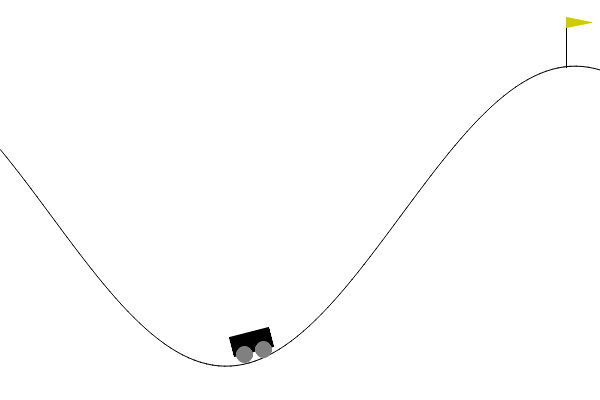
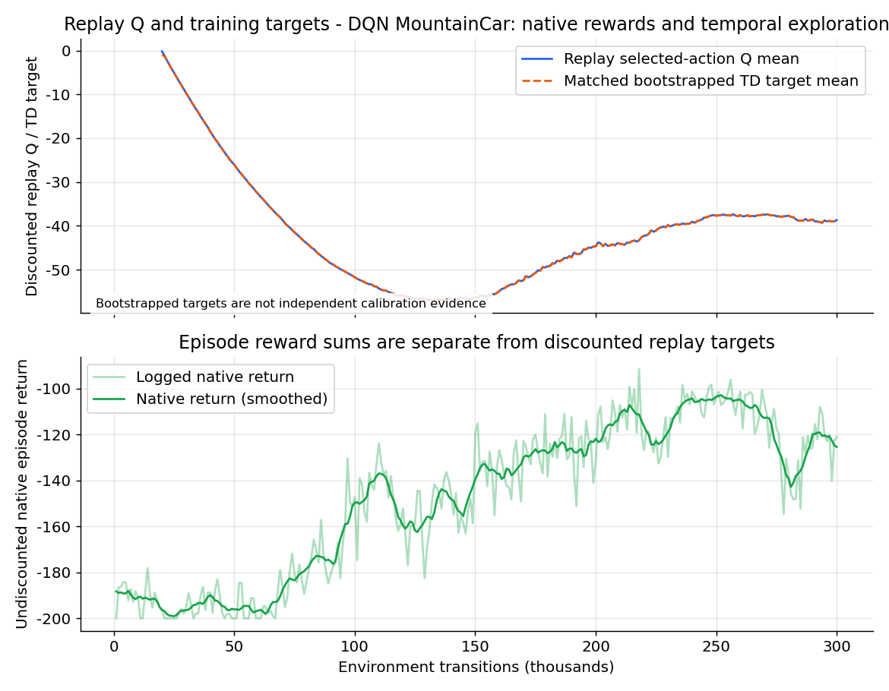
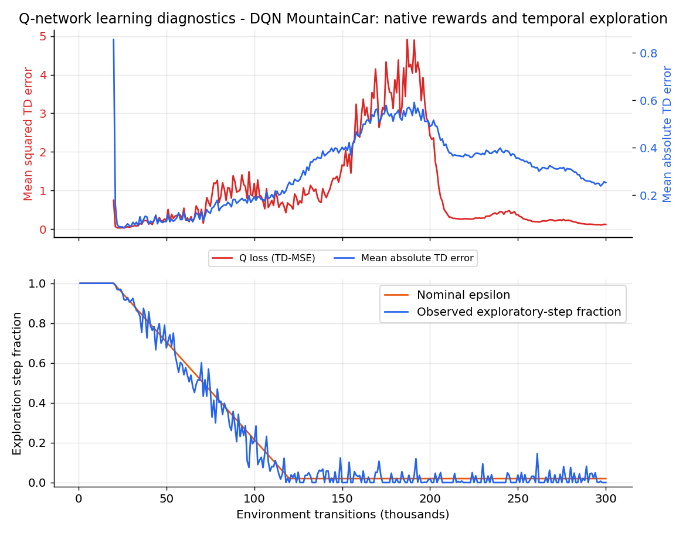
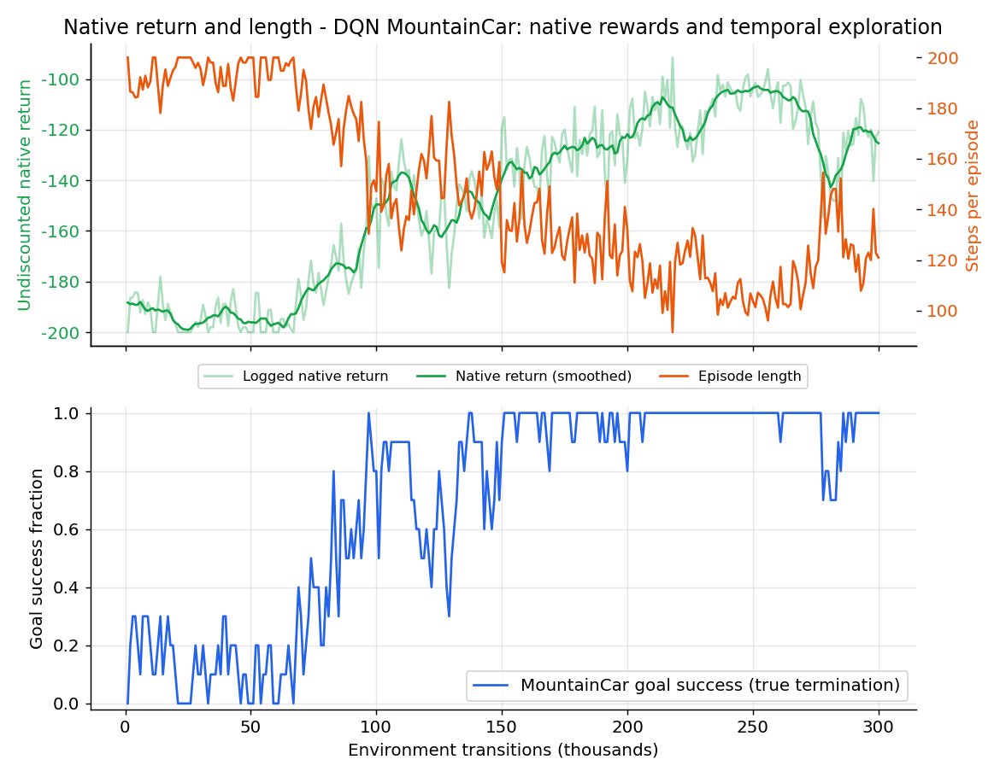

<p align="center">
  
</p>

<p align="center">
  
</p>

# Deep Q-Network (DQN)

## Overview

This package implements DQN and Double DQN in PyTorch for flat observations and
zero-based discrete actions. It collects transitions into a replay buffer,
optimizes an online Q-network against a delayed target network, and exposes a
YAML-driven Fire `train`/`demo` CLI. The benchmark is `MountainCar-v0`.

## Highlights

- Configurable Q-network, experience replay, random warmup and linear
  epsilon-greedy exploration decay.
- Double DQN separates next-action selection from target-network evaluation.
- Only true termination zeros the bootstrap. Time limits and safety caps end
  interaction without pretending the underlying next state is terminal.
- Target synchronization is measured in **gradient updates**, not environment
  steps. With `train_freq: 4`, a 1,000-update interval spans about 4,000 transitions.
- Checkpoints faithfully restore distinct online/target weights, Adam state and
  counters. Loading no longer overwrites the saved target with online weights or
  silently ignores optimizer errors.
- Deterministic action/value evaluation does not consume RNG or advance training
  counters. Replay and model inputs are checked for valid shapes and finite data.
- W&B key precedence is CLI, environment, then config. Public config excludes keys;
  evaluation records selected and saved training configurations separately.
- Native environment rewards are used for training and evaluation, without hidden
  shaping. Cleanup, final logging and final numbered checkpoints are guaranteed.
- The optional tuned recipe scales finite Box coordinates to comparable ranges.
  The flag and input bounds are checkpointed; raw replay observations and native
  rewards are unchanged, and incompatible encoding settings are rejected.

## What is DQN?

DQN replaces a tabular action-value function with a neural network. A behavior
policy explores while a greedy bootstrap target guides learning, making the
update off-policy. Replay reduces correlations between consecutive transitions.
A delayed target network avoids changing both sides of the TD regression on
every gradient step. Double DQN reduces one source of maximization bias, but
neither small TD loss nor matching mean Q/target values proves policy quality.

There is no separate policy-gradient actor or actor loss here. The Q-network
selects actions directly; the trainable objective is a Q-value regression loss.

## The math

Let $z_t=1$ only for true termination. A truncated transition retains its actual
final observation $s'_t$ in replay and keeps $z_t=0$.

### DQN and Double DQN targets

$$
y_t^{\mathrm{DQN}} = r_t + \gamma(1-z_t)\max_a Q_{\theta^-}(s'_t,a)
$$

$$
a'_t = \arg\max_a Q_\theta(s'_t,a)
$$

$$
y_t^{\mathrm{Double}} = r_t + \gamma(1-z_t)Q_{\theta^-}(s'_t,a'_t)
$$

### Regression and target updates

$$
\delta_t = y_t-Q_\theta(s_t,a_t), \qquad
L_Q = \mathbb E_{\mathcal D}[\delta_t^2]
$$

Adam minimizes this MSE with optional gradient-norm clipping. The reported
`td_error` is the mean absolute residual before the optimizer update.

$$
\theta^- \leftarrow \theta \quad\text{every } C \text{ gradient updates}
$$

Targets are computed under `no_grad`; target-network parameters are not trained
by the optimizer. This is a hard synchronization, not a soft target update.

### Optional observation encoding

For finite Box bounds, the tuned recipe applies the same affine transform to
current and next observations for action selection and Bellman updates:

$$
\tilde s = \frac{s-c}{h}, \qquad c=\tfrac12(s_{\mathrm{low}}+s_{\mathrm{high}}),
\quad h=\tfrac12(s_{\mathrm{high}}-s_{\mathrm{low}})
$$

This addresses the different position/velocity scales in MountainCar. It does
not change environment dynamics or reward. Replay stores native observations;
encoding is applied by the agent. Infinite or degenerate bounds cannot use this
option. Raw-observation checkpoints and normalized checkpoints are not silently
interchangeable.

### Exploration and returns

After random warmup, epsilon decays linearly from its start to end value over
`epsilon_decay_steps`. The baseline uses one-step epsilon-greedy selection:
a uniformly random action
with probability $\varepsilon_t$, otherwise online-network argmax. The revised
recipe uses the temporally correlated scheme below. Greedy evaluation always
uses argmax and leaves the training counter unchanged.

$$
G_0=\sum_{t=0}^{L-1}\gamma^t r_t
$$

An episode's undiscounted reward sum, its finite discounted return and a
bootstrapped continuing-task Q estimate are different measurements. Timeouts
especially make their horizons differ. Do not treat a raw Q/return gap as proof
of overestimation or calibration without matching state, policy and horizon.

### Temporally correlated exploration

The revised recipe repeats a randomly selected action for 20-60 transitions
while exploring. This is a behavior-policy change, not reward shaping. Greedy
inference does not use action holds. Random pulses are cleared whenever an
episode ends, including truncation and safety caps.

If the average hold length is $H$, using epsilon directly as the pulse-start
probability would greatly inflate the random-step fraction. The implementation
uses:

$$
p_{\mathrm{start}} = \frac{\varepsilon}{H(1-\varepsilon)+\varepsilon}
$$

This makes epsilon a nominal random-transition fraction under stationary,
uncensored conditions. Finite episodes and a changing schedule affect actual
occupancy, so the measured exploration fraction is logged separately. Holds of
one preserve the baseline's exact selection/RNG behavior.

### Algorithm summary

1. Seed model, replay sampling, environment and action-space RNGs.
2. Collect a native-reward transition; store a terminal-only bootstrap mask and
   the actual transition endpoint before resetting an ended episode.
3. Once warmup/batch-size requirements are met, sample replay every `train_freq`
   transitions and perform one DQN or Double DQN update.
4. Hard-sync the target after the configured number of successful optimizer steps.
5. Log native episode returns/lengths, exploration, replay size and Q/TD diagnostics.
6. Save numbered models and the best completed-training-episode window, then
   evaluate `best.pt` separately on fresh reset seeds without exploration.

### Symbol-to-code map

| Quantity | Code |
| --- | --- |
| Online/target action values | `q_network`, `target_q_network` |
| True-terminal mask | `ReplayBuffer.dones`, supplied from `terminated` |
| Double-DQN next action | `next_actions` in `DQNAgent.update` |
| Bootstrap target and MSE | `targets`, `loss` in `DQNAgent.update` |
| Q/TD diagnostics | `UpdateStats` |
| Gradient-update count and hard sync | `train_steps`, `target_update_interval` |
| Read-only initial max Q | `DQNAgent.q_value` |
| Warmup/linear exploration | `learning_starts`, `_epsilon_by_step` |

## Environment

MountainCar has two observations (position and velocity) and three actions. The
car must build momentum to reach the right-hand goal. Native reward is -1 per
step, including the goal transition, so better returns are less negative.
A successful episode has true termination; a 200-step time-limit truncation is
not success. The environment's mean-return threshold is -110.

The benchmark keeps the existing environment and native task. Classic-control
and rendering dependencies are already in the project; no Box2D or MuJoCo is
needed. Other flat-Box/discrete environments can be configured, but their
termination semantics must not be relabeled as MountainCar goal success.

## Quickstart

From the repository root, use a fresh named training environment:

```bash
uv venv .venv-dqn-train
source .venv-dqn-train/bin/activate
uv sync --active

WANDB_MODE=offline OMP_NUM_THREADS=1 MKL_NUM_THREADS=1 \
  uv run --active python -m deepQN.main train \
  --config deepQN/configs/mountaincar_exploration.yaml

uv run --active python -m deepQN.main demo --episodes 5 --render_mode none
```

The default recipe uses CPU. Small MLPs benefit from limiting CPU thread
oversubscription; `cuda`/`auto` remain available through config. Demo defaults to
headless when `render_mode` is null. Request a local window with
`--render_mode human` and use `--deterministic=False` only for deliberately
sampled evaluation, with `eval_epsilon` configured explicitly.

For cloud W&B logging, authenticate and select online mode yourself. Offline
mode stores local history without uploading; disabled mode cannot supply the
history required by the chart generator.

## Tests

Use a separate fresh environment:

```bash
uv venv .venv-dqn-tests
source .venv-dqn-tests/bin/activate
uv sync --active
OMP_NUM_THREADS=1 MKL_NUM_THREADS=1 \
  uv run --active python -m pytest tests/deepqn/ -q -W error
```

Unit tests use stub environments and mocked W&B, not real training. They cover
Bellman/Double-DQN arithmetic, terminal masks, hard-sync cadence, deterministic
behavior, replay data, distinct online/target and Adam restoration, counters,
configuration, train/demo cleanup, W&B precedence, metadata and asset helpers.
A fresh-environment run passed **75 tests and 153 subtests** with warnings
handled as errors. Real CPU training/evaluation, headless demo and asset tools
were also exercised; the unit suite itself uses stubs.
Run this directory separately from the other algorithms' suites.

## Configuration

The recommended default is `configs/mountaincar_exploration.yaml`: a 300k-step
normalized-input recipe with temporal exploration. `configs/mountaincar.yaml`
retains the raw 200k baseline, and `configs/mountaincar_tuned.yaml` retains the
first normalized 300k attempt. These earlier configurations are intentionally
preserved, not advertised as solved.

The configuration files control:

- Environment ID, kwargs, seed and default rendering.
- Hidden-layer sizes and activation.
- Exact transition budget, warmup, update frequency, replay capacity and batch size.
- Learning rate, discount, Double-DQN switch, hard-target interval and gradient clip.
- Linear exploration schedule and sampled-evaluation epsilon.
- Logging/checkpoint cadence in **environment transitions**, best window and paths.
- Maximum interaction steps per episode, including a safety cap for custom tasks.

The native MountainCar limit is 200 steps, shorter than the 1,000-step safety cap.
Only completed episodes enter best-model ranking; an unfinished final rollout is
not silently counted as a full episode. Checkpoints restore learner state with a
matching config, not replay contents, RNGs or the entire environment process.
Legacy checkpoints without a target field fall back to online weights; otherwise
the saved target lag is preserved exactly.

## Training results and analysis

All runs used native MountainCar rewards, the standard 200-step time limit and
training seed 42. Evaluation uses every requested episode with pure greedy DQN:
there are no action holds, reward shaping or filtered-away failures at test time.

| Recipe / policy | Evaluation seeds | Episodes | Mean native return +/- population std | Goal success |
| --- | --- | --- | --- | --- |
| Independent random actions | 1000-1099 | 100 | -200.00 +/- 0.00 | 0/100 |
| Untouched stock 200k control | 1000-1099 | 100 | -200.00 +/- 0.00 | 0/100 |
| Corrected raw-input 200k baseline | 1000-1099 | 100 | -200.00 +/- 0.00 | 0/100 |
| Corrected raw-input 200k baseline | 2000-2099 | 100 | -200.00 +/- 0.00 | 0/100 |
| First normalized 300k recipe | 1000-1099 | 100 | -200.00 +/- 0.00 | 0/100 |
| First normalized 300k recipe | 2000-2099 | 100 | -200.00 +/- 0.00 | 0/100 |
| Revised temporal-exploration 300k recipe | 40000-40099 | 100 | -99.97 +/- 8.56 | 100/100 |
| Revised temporal-exploration 300k recipe | 50000-50099 | 100 | -100.95 +/- 9.79 | 100/100 |

The revised recipe reached the goal in all 200 new held-out-start episodes.
Pooled native return was **-100.46 +/- 9.21**, above the environment's -110
mean-return threshold. The selected checkpoint is at transition **251,392**;
its sampled 20-episode selection window averaged -96.05. The full run still
completed 300,000 transitions.

The earlier failures were kept rather than hidden behind the old demo GIF.
A separate fully random exploration probe on 500 episodes per strategy found
0 goals with independent action choices, versus 64 with 20-60-step holds, 43
with 30-70-step holds, and 8 with 50-80-step holds. This informed the revised
exploration strategy. It is not an ablation proving that one change alone caused
the DQN improvement: input scaling, target cadence, optimizer/exploration
settings, warmup and checkpoint selection differ across recipes.

Fresh test seeds 40000 and 50000 were not used for the exploration probe or the
failed-recipe evaluations. They vary starting positions within the same fixed
MountainCar physics, not environments or dynamics. This remains one training
seed, not evidence across independent trained models.

For the first held-out range, mean initial max Q was -66.31 and mean observed
greedy discounted return was -63.25; their mean absolute difference was 3.06.
For the second range the corresponding values were -66.52, -63.57 and 3.16.
All these evaluation episodes truly terminated at the goal, so the discounted
returns cover the complete greedy trajectory. The value estimates remain
slightly more negative; reliable goal reaching is not exact Q-value calibration
or a proof of optimality.

The final sampled training window averaged -121, unlike the new greedy test
means. Exploration pulses can still perturb a sampled rollout. Raw per-episode
results, checkpoint/config provenance and summaries are saved in `deepQN/logs/`;
local W&B retains the full histories. The three refreshed charts use the revised
run's 300 logging points (281 with replay updates), and the GIF uses its selected
checkpoint, not an older successful-looking asset.

## Reproduce evaluation and assets

```bash
uv run --active python -m deepQN.utils.evaluate \
  --config deepQN/configs/mountaincar_exploration.yaml --episodes 100 --seed 1000 \
  --out deepQN/logs/evaluation.json

uv run --active python -m deepQN.utils.evaluate \
  --config deepQN/configs/mountaincar_exploration.yaml --random --episodes 100 --seed 1000 \
  --out deepQN/logs/random-baseline.json

SDL_VIDEODRIVER=dummy uv run --active python -m deepQN.utils.make_gif \
  --config deepQN/configs/mountaincar_exploration.yaml --out deepQN/assets/dqn_mountaincar.gif

uv run --active python -m deepQN.utils.make_charts \
  --run wandb/<offline-run>/run-<id>.wandb --out-dir deepQN/assets \
  --title "DQN on MountainCar" --summary deepQN/logs/training-summary.json
```

The evaluator reports every episode, native/discounted returns, initial Q,
position/goal/timeout diagnostics and checkpoint metadata in JSON and offline
W&B. It distinguishes checkpoint training config from evaluation config and
flags relevant mismatches; legacy training provenance can be unknown. The GIF
selects top episodes for display only. See `utils/README.md` for wrappers and
argument details. Model/log data are ignored, while PNG/GIF assets belong in
reviewable source changes.

## Training charts

<p align="center">
  
</p>

Matching replay Q/target means are a regression diagnostic, not calibration
proof; native episode returns have different units and horizons.

<p align="center">
  
</p>

The trainable loss is Q-value MSE, not an actor loss. A small residual alone does
not certify reaching the goal or adequate state coverage.

<p align="center">
  
</p>

Sampled training-window returns differ from fresh-seed greedy evaluation. Goal
success and native mean return are both reported rather than replacing failures
with a selected GIF.

## References

- Mnih et al., [Playing Atari with Deep Reinforcement Learning](https://arxiv.org/abs/1312.05602).
- Van Hasselt et al., [Deep Reinforcement Learning with Double Q-learning](https://arxiv.org/abs/1509.06461).
- [PyTorch DQN tutorial](https://docs.pytorch.org/tutorials/intermediate/reinforcement_q_learning.html).
- [Gymnasium MountainCar](https://gymnasium.farama.org/environments/classic_control/mountain_car/).
